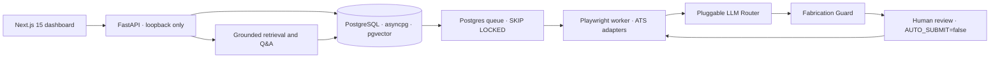

# Job_Runner

A local job-search and application workbench that turns postings into evidence-backed matches, tailored résumés, and reviewable application packets. You own the data and approve what gets submitted.

Built to explore the engineering behind dependable AI workflows: async ingestion, retrieval evaluation, source attribution, browser automation, durable queues, and human review.

## Architecture



PostgreSQL is the system of record. Résumés, browser sessions, and screenshots stay in local storage. The dashboard proxies API requests over loopback. This is a single-user development tool; it has no network-facing authentication layer.

## Engineering highlights

- **Adversarial Tailoring Guard:** source-scoped evidence checks reject invented skills, dates, credentials, metrics, and claims borrowed from another résumé entry. Tests include adversarial rewrites; review exposes accepted changes and rejected attempts.
- **ATS Contract:** adapters in `packages/ats/` share inspection, field mapping, fill reports, and explicit failure reasons. Unknown answers park the application with the employer's exact question. CAPTCHA and unsupported flows require manual completion.
- **Grounded Q&A:** keyword constraints, model-specific chunk retrieval, reciprocal rank fusion, and citations tie answers to stored postings. Counts and application states come from SQL. Retrieval benchmarks measure fidelity separately from human relevance.
- **Durable execution:** PostgreSQL leases and `FOR UPDATE SKIP LOCKED` support retries; a state machine and append-only events record progress. A submission ledger fences duplicate attempts.
- **Replaceable model providers:** local and explicitly selected remote providers share routing and audit boundaries. No production request silently falls back to test stubs.

## Quickstart

Prerequisites: Python 3.12, Node.js 22, npm, Docker with Compose v2, and native PDF libraries. On macOS: `brew install pango cairo gdk-pixbuf libffi`. On Debian/Ubuntu: `sudo apt-get install -y libpango-1.0-0 libpangocairo-1.0-0 libcairo2 libgdk-pixbuf-2.0-0 libffi8` (see also [Dockerfile](Dockerfile)).

```bash
make demo
```

This installs missing dependencies, starts loopback-only PostgreSQL, migrates a separate `jobrunner_demo` database, seeds synthetic fixtures, and starts the API and dashboard. Open **http://127.0.0.1:3001**. Ports 8000 and 3001 must be available. Ctrl-C stops the foreground demo services; `make down` stops the database without deleting its volume.

Explore `/matches` (10 scored jobs), `/review` (a résumé diff and an unanswered question), `/resumes` (internships, certifications, and three synthetic GitHub imports), and `/tracker` (interview, assessment, awaiting, and rejected outcomes). Rerunning preserves reviewer edits. All job links use reserved `demo.invalid`; nothing is sent. Fixture scores are illustrative. The demo starts no worker and needs no LLM or GitHub credentials. Live assistant generation requires a configured local model.

To prepare without starting servers: `DEMO_PREPARE_ONLY=1 make demo`. The isolated settings and artifacts live under ignored `storage/demo/`. Set `DEMO_ROOT` to an absolute temporary directory to keep all demo files outside the checkout. If the default ports are occupied, use `DEMO_API_PORT=18000 DEMO_WEB_PORT=13001 make demo`.

## Configuration

For your own profile, copy `.env.example` to `.env`, then run:

```bash
make install
make nltk-data
playwright install chromium
make up
make migrate
make web-install
make doctor
# Separate terminals:
make api
make web
make worker  # starts real queued work; configure your profile first
```

Select `LLM_PROVIDER=ollama` (and install/pull the local model) before real tailoring; `.env.example` sets `LLM_PROVIDER=stub` for tests and offline checks. See [docs/USAGE.md](docs/USAGE.md) for provider setup, dashboard routes, and troubleshooting.

The complete environment template is [.env.example](.env.example); defaults are defined in `packages/core/config.py`.

| Setting | Purpose |
| --- | --- |
| `DATABASE_URL` | PostgreSQL with pgvector; Compose uses a public local-development credential |
| `AUTO_SUBMIT=false` | Keep the approval gate; profiles also have their own opt-in |
| `LLM_PROVIDER`, `LLM_TASK_*` | Select model routing; `stub` is for tests/demo fixtures, `ollama` for local inference |
| `OLLAMA_*`, provider API keys | Configure only providers you explicitly choose; remote calls can transmit résumé text |
| `GITHUB_USERNAME`, `GITHUB_TOKEN` | Optional project import; token needed for private repos and higher rate limits |
| `VAULT_KEY`, `VAULT_ROOT` | Encrypt ATS credentials; generate a key with `make vault-key` |
| `STORAGE_ROOT` | Local résumés, artifacts, and browser state; excluded from git and Docker |
| `JOBRUNNER_ENV_FILE` | Select a private settings file outside the checkout |
| `VECTOR_BACKEND` | `pgvector` (exact default), `pgvector_hnsw`, or optional `redis_hnsw` |

Optional vector setup and a reproducible latency/Recall@10 benchmark: [docs/VECTOR_BACKENDS.md](docs/VECTOR_BACKENDS.md). For live workflows, see [docs/USAGE.md](docs/USAGE.md). Architecture specifications live in [CLAUDE.md](CLAUDE.md); design experiments and limitations live under `docs/`.

## Development and license

See [CONTRIBUTING.md](CONTRIBUTING.md) for checks and ATS adapter development, and [SECURITY.md](SECURITY.md) for the trust model and vulnerability reporting. [MIT licensed](LICENSE).
