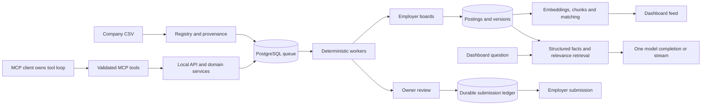

# Jobrunner harness and database audit — 2026-10-15

Audit only. No product changes, production writes, new databases, crawls, employer submissions, mail sending, project dependency installs, or model-provider calls were performed. Existing test fixtures wrote only to the positively marked test database. Unrelated working-tree changes were preserved. Separately, the owner subsequently requested `npx skills add JuliusBrussee/caveman -g`; that global skill installation was performed under the new instruction and is not an audit implementation phase or project framework installation.

Evidence basis: checkout `87487bc` (`tmp/all-phases`), resolved local configuration, read-only PostgreSQL queries, local health requests, executable MCP probes with fake HTTP clients, and isolated tests. At final inspection, the local `origin/main` reference was `50a7eed`, including merged PRs #165–167. It differs from the audited checkout in seven security/CI files; those newer Origin-parser changes are not claimed as deployed by this audit. No checkout or deployment was performed. Required project contracts and relevant RAG/evaluation documentation were read; code and observations take precedence over older prose.

Raw evidence and reproduction instructions: [evidence index](harness-audit/evidence-2026-10-15/README.md). Tool contracts: [35-tool matrix](harness-audit/tool-contracts-2026-10-15.md), [actual wire schemas](harness-audit/evidence-2026-10-15/tool-schemas.json). Observations are snapshots, not continuous monitoring or a production acceptance certificate.

## Status update — 2026-10-18

PR state was checked with `gh pr view`, including each merge commit, before
this note was written.

| Audit phase | Merged implementation |
|---|---|
| Phase 2 — fence worker ownership and bound retries | #169 `fix(worker): fence queue claim settlement` (`4bccd1f`) |
| Phase 3 — separate credentials and private runtime paths | #170 `fix(db): separate runtime credentials` (`c937f6f`); #171 `feat(core): stage private runtime paths` (`5d9c02a`) |
| Phase 4 — truthful outcomes and operational evidence | #172 `fix(mcp): flag API failures in protocol` (`5000254`); #173 `feat(harness): correlate requests and worker calls` (`0e7a3b3`); #174 `fix(harness): make remote audit reservations durable` (`5e4eb15`); #175 `fix(inbox): checkpoint IMAP ingestion atomically` (`a7601ba`); #176 `fix(web): show crawl status disconnects` (`efc5a44`); #177 `fix(inbox): sustain mailbox polling loop` (`8a3ef3c`) |
| Phase 5 — retrieval evaluation | Started 2026-10-18 on `fix/retrieval-filter-before-limit`: filter-before-limit starvation fixed and measured ([report](harness-audit/phase-5-retrieval.md)). The owner-graded baseline and the switch evaluations still require owner grades (0 today) and approved thresholds. |

The root checkout, API and four-worker pool now run `main` at `8a3ef3c`, and
the live schema is at `c4e8a1b7d290`. The runtime role from #170 has not been
provisioned, and the private paths staged by #171 have not been moved out of
the iCloud-managed Desktop. Long-lived MCP processes must be restarted before
they load #172–#177. See the [production-state record](harness-audit/production-state-2026-10-17.md).

## A. Executive verdict

Keep the existing FastAPI/Next.js/PostgreSQL/pgvector architecture. The repository has a substantial functioning application, deterministic workers, submission fencing, grounded chat, and MCP integration. It does **not** have one unified autonomous agent harness. A new workflow engine or vector store would not resolve the demonstrated defects.

The first implementation phase addresses the **MCP owner-confirmation gap** in merged PR #168. Before that patch, a parked application with no unanswered questions reached `approve: true` without an owner form, and `start_crawl` similarly relied on client-specific permission metadata. Both were reproduced using fake clients, with no employer contact. PR #168 requires affirmative server-side elicitation for both writes. It is merged on `main`; restarting any long-lived MCP process on the merged revision remains an operational deployment step.

Next priorities are worker claim ownership/retry bounds, persisted-error redaction, runtime database privileges, and private-file placement. These precede retrieval experiments or framework adoption.

| Status | What the evidence establishes |
|---|---|
| Implemented and exercised in live operation | Registry/crawl storage, posting vectors/chunks, matches, application history, queue history, model-call audit records. Live database contains 4,382 companies, 12,776 postings, 168,873 chunks and 5,154 matches. Historical audit entries establish recorded call intent, not successful delivery. |
| Implemented and fixture-tested | Submission fencing, approval races, reconciliation, database target guards, MCP IDs/elicitation, retrieval filters, fabrication checks, host budgets, inbox classification and lifecycle/status behavior. **766 existing tests passed, zero skipped** in two focused runs. |
| Implemented but operationally inactive/unverified | Inbox route is wired through rules → Bayes → optional local LLM, but IMAP is unconfigured and live mail count is zero. Workers had no fresh heartbeat; one due crawl task remained. Notification default resolves to logging; desktop delivery is not demonstrated. |
| Experimental or disabled | Chat reranker and semantic expansion disabled. Untracked LlamaIndex prototype/evaluation files are experiments, not deployed consumers. Benchmark-only scoring is not production chat ranking. |
| Proposed or missing | Server-enforced confirmation on every sensitive MCP approval; generic agent-run lifecycle/budgets; unified tool-call outcome trace; complete truncation accounting; least-privilege environment credentials; owner-labeled relevance baseline. |
| Deliberately excluded | Autonomous employer submission as evaluation, CAPTCHA/bot evasion, multi-tenancy, paid/cloud infrastructure, extra authoritative databases, new workflow/vector platforms. |
| Unverified | Successful live submission under the new fence, real-mail recovery, full restore recovery, sustained capacity, end-to-end model quality, live browser disconnect behavior, all currently running process versions. |

Five legacy submission-ledger entries are `uncertain`; there are no confirmed entries in this snapshot. This does **not** prove that no application was sent externally. Reconcile with owner evidence; never retry these automatically.

## B. Architecture and execution ownership

| Path | Concrete implementation and consumer | Ownership and remaining boundary |
|---|---|---|
| A. CSV → postings | [import_companies.py](../scripts/import_companies.py) `_register`; [registry.py](../packages/crawler/registry.py) `register_candidates`/`sync_registry`; [crawl_job.py](../apps/worker/crawl_job.py) sweep dispatch; [discover_job.py](../apps/worker/discover_job.py) discovery; [crawl_company_job.py](../apps/worker/crawl_company_job.py) fetch; [crawl.py](../packages/crawler/crawl.py) storage/closure. | CLI/API initiates; PostgreSQL dispatch and worker handlers own execution. Imported, queued, attempted, verified and fetched are different states. Discovery failure means unresolved source, not zero vacancies. |
| B. Posting changes → feed | Content hashes/version records → [incremental.py](../packages/matching/incremental.py) `run_matching_pass` → posting embedding and match scores → [chunks.py](../packages/matching/chunks.py) → API matches/feed. | Worker transaction owns refresh. Chunking is awaited before this transaction commits; the comment that slow chunks never delay scores overstates when scores become visible. |
| C. Question → answer | [chat.py](../apps/api/routers/chat.py) `prepare`, structured application/profile/mail context, [retrieve.py](../packages/matching/retrieve.py), history assembly, `provider.complete`, `reply_for`; streaming shares preparation. | Dashboard issues a bounded retrieval-plus-completion request. The model does not execute tools in this path. Completion is not an autonomous multi-step agent. |
| D. MCP → operation | [server.py](../apps/mcp/server.py) → [client.py](../apps/mcp/client.py) → typed FastAPI routes → domain services. | External MCP client owns tool choice, iteration and run budgets. Local stdio/client configuration is the access boundary; permission metadata is not universal server authorization. |
| E. Preparation → submission | [applications.py](../apps/api/routers/applications.py) → queue → [apply_job.py](../apps/worker/apply_job.py) `run_pipeline`, résumé pin/tailor, adapters, `_decide`, `_submit` → [submissions.py](../packages/core/submissions.py). | Deterministic state machine owns transitions. Approval/OTP parks require owner participation. Candidate lock + ledger fence guards the irreversible click, independently of model prose. |
| F. Mail → follow-up | [inbox_job.py](../apps/worker/inbox_job.py) → [imap.py](../packages/inbox/imap.py) → [classify.py](../packages/inbox/classify.py) `classify_message` → match/route → application events and tracking tasks → API/MCP follow-ups. | Worker owns polling and classification. Local LLM fallback is connected, contrary to older audit prose; live operation remains unverified. IMAP `RFC822` fetch can mark mail seen before durable processing, with no durable UID checkpoint. |
| G. Worker → indicator | Queue leases + worker heartbeats → [crawl.py](../apps/api/routers/crawl.py) → [crawler-spider.tsx](../apps/web/src/components/crawler-spider.tsx); application events also feed status stream. | API aggregates sweep/discovery/company handoffs. Due sweep and discovery/company work count; a future sweep alone does not. Expired leases do not establish activity. UI polls; browser rendering during disconnect was not exercised here. |

There is no fourth, in-process autonomous loop to deploy. Do not infer one from having MCP tools, a chat endpoint and workers in the same repository.

## C. Database ownership and environment isolation

Live read-only connection resolved to `localhost:5433/jobrunner`; PostgreSQL 16.15, pgvector 0.8.6, Alembic `b8f4c2d6e901`. The audit connection verified `transaction_read_only=on`; query timeout was 15 seconds. Passwords and URLs containing credentials are excluded from evidence.

| Environment | Verified state and authority | Isolation, migration and recovery requirements |
|---|---|---|
| Live | One authoritative `jobrunner` DB. Companies/provenance, canonical jobs/posting versions, profiles/preferences, applications/events/approvals, `applied_postings`, queue/leases/heartbeats, crawl budgets/state, embeddings/chunks, matches and operational records. | Keep application state and ledger together. Existing Alembic owns schema migration; a future migration role should own DDL, runtime role only required DML. Back up database plus referenced artifacts. No migration performed. |
| Test | Existing `jobrunner_test`, database comment `jobrunner:test`. Isolated tests ran here. | [conftest.py](../tests/conftest.py) compares live/test host+port+database, normalizes loopback aliases, verifies server-side identity/comment before destructive setup and holds the database ownership advisory lock. It creates fixture metadata rather than proving every migration path. DNS aliases are not an identity proof; keep the positive marker. Separate credentials are still missing. |
| Evaluation | No `jobrunner_eval*` DB observed; not created. File-based evaluation datasets/scripts exist. | Optional future environment only. Sanitized data, explicit marker + target collision checks, production workers/outbound integrations disabled, dedicated credentials, dataset/config hashes. Apply pinned migrations as evaluator setup; never authoritative for applications or approvals. |
| Restore verification | No `jobrunner_restore*` DB observed; not created. Verification implementation exists. | [verify.py](../packages/backup/verify.py) rejects live DB name and overlapping artifact paths; exclusively creates a prefixed disposable DB, validates manifest/checksums/counts and cleans up its own target. However it derives administration/restore connections from the live URL, reusing production credentials. Dedicated restore/admin identity and explicit outbound-disabled environment remain needed. No fresh restore claim. |

The only observed login role, `jobrunner`, has **SUPERUSER, CREATEDB, CREATEROLE and BYPASSRLS**. Thus logical test isolation exists, but credential least privilege does not. A compromised API/worker could reach beyond its intended database. Read-only audit mode does not mitigate the application's privileges. The existing [role migration proposal](harness-audit/database-role-migration.md) is a plan, not an applied change.

Local files are part of recovery: résumé PDFs and receipt/screenshots/browser state under `storage`, vault/key material under `.secrets`, logs/audit and backups outside relational rows. Observed approximate directories: résumés 1.1 MiB, receipts 344 KiB, browser state 11 MiB, logs 114 MiB, exports 103 MiB, embedding benchmark 633 MiB, `.secrets` 5 MiB, backups 4.3 GiB. Repository lives under Desktop, whose file-provider attribute identifies iCloud Drive. This establishes a provider-managed location, not proof that particular secrets were uploaded. Move private runtime artifacts through an explicitly approved, verified migration; do not casually move the working repository or destroy backups.

No measured need supports splitting live data across databases. Vectors, corpus statistics and indexes are derived/rebuildable; approvals, submission fences and events are authoritative and must not be reconstructed from embeddings or model summaries.

## D. Tools, permissions and trust boundaries

The [tool matrix](harness-audit/tool-contracts-2026-10-15.md) inventories all **35** registered tools, including input/schema links, operation class, approval, idempotency and returned evidence. Shared HTTP/error/cancellation/redaction contracts apply to every row. Actual output schemas are generic JSON objects, not domain-specific typed results.

Direct MCP dispatch with a fake API reproduced:

| Probe | Observed result | Meaning |
|---|---|---|
| `approve_application`, no unanswered questions, no owner form context | API received `approve: true`; MCP error flag false. | `_owners_answers` returns `_NothingOpen` before checking elicitation support. Required approval is delegated to metadata/client behavior. |
| `start_crawl`, no owner form context | API received `POST /crawl`; MCP error flag false. | A generic client can bypass the intended “ask every time” policy. This probe did not actually start a crawl. |
| `crawl_status`, fake unavailable API | JSON contained `error`; MCP error flag false. | `_call` converts exceptions into ordinary dicts; a consumer can mistake failure for successful execution. |

Identifiers remain narrowly validated (`[A-Za-z0-9_-]{1,64}`); malformed identifiers fail without echoing the payload. OTP and grading use server-side elicitation; employer-question answers are not ordinary model arguments. Preserve those protections. No arbitrary SQL, shell, filesystem or generic HTTP tool is exposed by this server.

Untrusted postings, email, CSV cells and tool output must remain data. Prompt instructions alone cannot authorize a write; server checks must survive a client that follows injected text. Local Host checks reduce browser/network exposure but do not authenticate intent from a local MCP client. Health probes accepted localhost (200) and refused hostile Hosts (API 401, dashboard 403); listeners were loopback on ports 5433/8000/3001. No second-machine or full Origin matrix was exercised against running services.

## E. Memory and bounded execution

| Memory | Existing ownership, provenance and consumer | Gaps and correction/deletion policy |
|---|---|---|
| Working | Client conversation history; [chat_history.py](../apps/api/chat_history.py) keeps last three turns, clips questions to 300 and answers to 500 characters, re-reads up to six cited postings. Mail/protected-topic withholding is reported; history is explicitly not factual authority. Pending owner input lives in application review state. | Older turns/character clipping do not have complete dropped-token/source accounting. No durable general-purpose run checkpoint. Clear client history to remove conversation copy; it must never update protected profile fields. |
| Procedural | Repository contracts, skills, versioned prompts and deterministic domain/state-machine code. Git/prompt version supplies provenance. | Treat retrieved instructions as data. Changes require ordinary reviewed code/prompt versioning; no model-generated policy consolidation. |
| Semantic | Owner-entered candidate/profile/resume facts; explicit search/ranking preferences; sourced company/posting records with hashes, URLs and timestamps. Embeddings are derived indexes. | Owner correction via existing edit paths; reindex derived data after source edits. Imported or inferred facts must retain that provenance. Work authorization, salary answers, credentials/history and approval cannot be inferred from conversation. No new memory table is justified. |
| Episodic | Application events and ledger, crawl/task/heartbeat records, inbound-message inference, local model audit files; client conversation storage. | No comprehensive durable tool execution journal or run-to-call correlation. Retention differs by store; no demonstrated unified correction/deletion/export workflow. Keep inferred mail classifications distinguishable from owner decisions and preserve reconciliation evidence. |

Posting retention is configured to 30 days with application-linked preservation in the pruning path; this is not a universal retention policy for mail, browser sessions, logs or backups. Audit digests avoid raw prompts but remain sensitive metadata. Any new event must specify actor/owner, source IDs, UTC time, version, sensitivity and retention. Proposed tool events should store IDs/digests and outcomes, not résumé/mail/OTP contents. Deleting a résumé or conversation must not erase a submission fence that prevents a duplicate. Any legally/policy-driven erasure workflow needs a separate explicit design; none is asserted here.

No memory consolidation is proposed. If later needed, summaries must link source events, identify inference and support correction; never promote guesses into authoritative profile facts.

### Current loop bounds

| Loop | Current bounds/checkpoints | Defect or limit |
|---|---|---|
| Dashboard chat | One completion/stream, 600 answer-token limit, finite retrieval/history pools; provider-specific timeout/quota and local context checks. | No multi-step tool run. Character clipping is not a complete context/token budget report. Cancellation does not prove provider-side work stopped. |
| MCP client | API client has 30-second per-request HTTP timeout, no automatic request retry, and warns that timed-out writes may have completed. | No server-wide total deadline, step budget, repeated-action detector, generic outcome journal or run cancellation/resumption. Client owns these. HTTP timeout is not rollback. |
| Workers | Queue task IDs, 300-second default lease, renewal at one-third lease, default three handled failures, durable application transitions; host/request budgets and deferred crawl work. | **Reproduced:** repeated lease expiry bypasses attempt limit; stale claimant completes new owner's task. Renewal loss logs and lets handler continue. No universal handler deadline. Discovery scheduling is bounded in delay, not a universal lifetime attempt ceiling. |
| Submission | Durable intent before click; ambiguous outcomes fence and park. | Preserve uncertainty; never apply ordinary blind retry logic to employer writes. |

If a genuine multi-tool consumer is approved later, define a separate `AgentRun`, not an `ApplicationStatus` replacement. Initial design candidate: immutable objective/acceptance predicate, allowed tool set, request/run IDs, at most eight tool calls, one in flight, 30-second call deadlines and five-minute active execution deadline; at most one retry of a safe read; identical ineffective action twice stops. Owner waits pause execution and require a fresh scoped decision on resume. Default remote request budget zero; any approved remote run needs a concrete token/request/cost ceiling before starting. Unknown usage remains unknown, and providers without enforceable limits cannot qualify for a strict cost ceiling.

Candidate run states: `created → executing → waiting_for_owner → executing → completed/failed/cancelled/budget_exhausted`. Checkpoint accepted intent and redacted observation; record verification/stop reason. Cancel before new side effects; after an uncertain write, reconcile durable state instead of replaying. Tool allowlists, budgets and stop rules belong outside model prose. This is a design candidate, with no new table, framework or loop implemented by this audit.

## F. Risk-ranked findings

| Priority | Finding and evidence | Bounded remedy |
|---|---|---|
| High | MCP approval/start-crawl relied on metadata when owner input was absent. Reproduced fake-client dispatch; [server.py](../apps/mcp/server.py) `_owners_answers` near 471, `approve_application` near 501, `start_crawl` near 959. | Phase 1 merged in PR #168: server-side affirmative confirmation bound to the operation/application; unsupported, unchecked, declined and cancelled elicitation fail closed. Restart long-lived MCP processes on the merged revision. |
| High | Stale queue owner can mark reclaimed task done; crash recovery can claim beyond three attempts. Three isolated probes include two failures proving these paths; [queue.py](../packages/core/queue.py) `claim_task`, `complete_task`; [run.py](../apps/worker/run.py) lease-loss handling. | Compare-and-set mutations by claim identity (owner plus attempt/generation), explicit crash-retry exhaustion and safe lease-loss handling. Preserve submission uncertainty. |
| High | Runtime role is cluster superuser; test/restore reuse privileged credentials. Live catalog + restore code. | Staged runtime/migrator/test/backup/restore separation with grant inventory and rollback. No live privilege changes without approval. |
| High | Sensitive files resolve beneath provider-managed Desktop. Configuration + file-provider metadata. | Approved private-path migration with manifests, permissions, restart/restore verification; establish backup ownership/retention. |
| Medium | Worker logs redact exception to class, but `_process` passes raw `str(exc)` into `_fail` and queue persistence. Synthetic sentinel reproduced at persistence boundary. | Store bounded safe codes/summaries; keep raw sensitive text out of queue/events/API. Test both retry and exhaustion. No claim that a real secret leak was observed. |
| Medium | Tool errors have success protocol flag; all 35 output schemas are generic objects. Fake unavailable-API probe. | Stable typed success/error contracts and proper MCP error semantics; preserve “write outcome unknown” distinctly from safe retry. |
| Medium | Model audit records intent before request, lacks linked outcome/run/task/application IDs, and swallows append failure. File-based quota has no cross-process reservation. | Add correlated redacted attempt/outcome events and atomic budget reservation only where needed; fault/concurrency tests. Do not call 732 remote-marked records confirmed successful uploads. |
| Medium | Retrieval area/level filtering follows the initial limited keyword/vector candidate scan in some branches. `_keyword_hits` limits before Python area filtering; chunk scan has global top-200 bound. | Reproduce candidate starvation with larger adversarial fixtures; move applicable filters before limits without altering exact-role/count semantics. Production miss rate unmeasured. |
| Medium | IMAP UNSEEN/RFC822 fetch can mark read before commit; no durable UID checkpoint. Wired fallback, no live mail evidence. | Explicit read-only/PEEK fetch and durable mailbox/UID checkpoint/dedup/replay policy, fake IMAP fault tests before enabling. |
| Operational | One due crawl with no fresh worker; 11 failing board-state rows associated with 60 still-open postings. Latest success among those rows as old as September 18. | Surface stalled/freshness truth; restart only on owner instruction. Preserve old postings with warnings rather than claim no jobs or silently close on fetch failure. |
| Quality | Zero owner labels; fixture and historical known-target results cannot establish owner relevance or supported answers. | Freeze an owner-labeled baseline and thresholds before any candidate tuning. |

### Submission fence assessment

[apply_job.py](../apps/worker/apply_job.py) `_submit` (near 1131) re-reads locked state, takes candidate-scoped coordination, checks canonical identity and ledger, commits intent before employer click, and records confirmed submission before optional screenshot work. [submissions.py](../packages/core/submissions.py) holds the shared ledger logic. Approval routes revalidate under locking. Adapter evidence distinguishes new confirmation text from pre-existing text. Fixture tests cover retries, concurrent attempts, uncertainty and reconciliation.

These are **durable fencing plus at-least-once queue handling and reconciliation**, not exactly-once employer delivery. A successful click can precede loss of its response. That uncertainty must remain blocked. Owner reconciliation can mark confirmed or explicitly unsent through existing guarded routes; the five legacy uncertain rows were left unchanged. No live click was used as a test.

### Retrieval and measured capacity

Assistant retrieval and résumé-to-job scoring are separate consumers. Current posting vectors are `lexical-idf@2`, revision 1 (12,773 open rows, one open row lacks both description/vector); model configuration also supports sentence-transformer embeddings. Chunks use normalized-text offsets, 500-character windows/25 overlap, content hashes and model stamps, with BGE small 384-dimensional half vectors. The historical default stamp is `sentence-transformers`; alternate models use distinct stamps. Version strings alone cannot prove a historical artifact's binary provenance.

Chat combines keyword/vector candidates using RRF (`k=60`) with bounded pools, structured role/location/sponsorship logic and exact counts/status from SQL. It excludes closed postings from new search; earlier conversation references may intentionally show a posting labelled closed. Benchmark BM25/RRF résumé matching is a different path. Reranking and semantic expansion were off in resolved configuration.

| Measurement | Observed value and interpretation |
|---|---|
| Corpus | 12,776 postings; 12,774 open; 168,873 chunks, 168,858 attached to open postings. Fifteen closed-posting chunks remain stored but are excluded from new retrieval. |
| Freshness/coverage | Zero hash-stale chunks; zero open text-bearing postings missing current BGE-stamped chunks. One open posting has no text/vector. Model stamps are compatible by code checks, not independently re-embedded in this audit. |
| Ingestion | 2,033 postings first seen in preceding 24h. This is an observed count, not sustained throughput. Latest chunk timestamp 06:58:14 UTC. No active-worker throughput test. |
| Storage | DB 388,660,247 bytes (~371 MiB); chunks ~202 MiB including ~20.6 MiB indexes; postings ~111 MiB. Existing vector tables have B-tree indexes, no ANN index. |
| Query sample | Nine exact top-200 chunk queries using one stored vector: 36.49–64.26 ms, median 47.99 ms. Raw samples saved. This excludes query embedding, keyword search, context assembly and model completion; too few correlated samples for a reliable p95. |
| Query plan | Parallel sequential scan + hash join + top-N heapsort, two workers; EXPLAIN execution 46.812 ms, sort ~48–49 KiB per worker and hash ~1.6 MiB. Select-only EXPLAIN ANALYZE. |
| Connections | One audit query active, two idle live-DB connections. Default configured pool 5 + overflow 10; worker CLI has pool sizing safeguards. This is not a pressure/load test. |
| Host resources | 16 GiB RAM, 10 logical CPUs. Host filesystem reports ~68 GiB available, 85% used. Does not establish Docker volume headroom. A process-name sample matched only two services (21.8 MiB RSS, 0% CPU); excludes container PostgreSQL/other unmatched processes and is not a capacity result. Per-container peak CPU/RSS remains unmeasured. |
| Rebuild/recovery | No rebuild executed. [ML_EVALUATION.md](ML_EVALUATION.md) around 2108 records a historical experimental 145,200-chunk embedding run in 891 seconds on four CPU threads. Different corpus/experiment; not a current full production recovery time. Fresh DB+artifact restore RTO/RPO remains unverified. |

Sources returned by chat carry posting IDs, labels, URLs, kind and retrieval counts. Unsupported-label checking catches invented citation labels; it does not prove that every sentence is supported by the cited text. No answer-support quality estimate was measured. Preserve exact SQL facts for submission/approval/time/count questions; never substitute semantic similarity.

## G. Evaluation results and release evidence

| Area | Actual audit evidence | Limitations / next gate |
|---|---|---|
| Core safety/integration | **395 passed in 101.53s, zero skips**: submission ledger/reconciliation, review-once, positive DB ownership/collision/lock, red-team, MCP/IDs/status/grading/tracking, crawl status, worker pool, retrieval/area/seniority/sponsorship, history, chunk stamps and audit attribution. | Fixtures/stubs and isolated real PostgreSQL; not live employer behavior, production model quality or every repository test. |
| Adjacent correctness | **371 passed in 21.14s, zero skips**: fabrication, answers, model routing, request budget, robots/shared/concurrent rate limiting, chat grounding, inbox classification/dedup/inference, notifications/reparking, status stream. | Stubbed model/browser/mail data; not real mail recovery, desktop notification delivery or browser UI rendering. |
| New worker diagnostic probes | **3 expected assertion failures in 1.41s**: crash retry limit, stale owner completion, raw exception persistence boundary. Sources saved outside normal test collection. | Stale-owner probe explicitly changes authoritative ownership while retaining an old ORM object; not a full two-process stress test. Redaction probe intercepts persistence argument; no real credential used. |
| New MCP diagnostic probes | Three observations saved: ownerless approval forwarded; ownerless crawl forwarded; unavailable API reported with false error flag. | In-process MCP dispatcher and fake HTTP client, not a particular installed client's UI. No outbound side effects. |
| Live operational read-only | Positive test marker and live schema/role inspection, aggregate DB counts, nine SELECT timings + query plan, health/Host probes, local file/config inspection. | Snapshot only; no load test, writes, restart, crawl, model completion or submission. |
| Model/retrieval/résumé quality | Existing evaluation documentation inspected; live owner label count zero. | No newly executed Recall@K/MRR/NDCG, answer support, abstention, recruiter assessment, PDF round-trip or selected-résumé E2E quality study. Existing guards are necessary but not a quality score. |
| Restore/migration/browser/full suite | Not run in this audit. | Restore and some migration tests create disposable DBs, expressly outside this request. Full suite was intentionally not used. API disconnect UI and second-machine access remain unverified. |

Separate future gates:

1. **Operational:** fixed corpus/config and hardware; queue age/liveness, lost-lease recovery, retry amplification, ingestion/backlog, query latency distribution and connection/RSS peaks. No employer crawl needed for deterministic fixtures.
2. **Safety:** no unconfirmed MCP approval; no click after duplicate claim/retry; uncertainty parks; no fabricated facts or altered work-authorization answers; positive environment identity; injection cannot authorize tools; redacted persisted errors; remote-provider choice stays explicit. Release requires every deterministic assertion, with no critical skip.
3. **Retrieval:** versioned owner labels and query strata (exact company/skill, paraphrase, seniority, location, sponsorship, closed/missing/stale/model-mismatch). Freeze baseline and held-out split before candidate selection; record Recall@5/20, MRR, NDCG@10, relevant coverage, supported citations and abstention. No tuning on held-out labels.
4. **Résumé:** source-supported facts/metrics/technologies/attribution, no unauthorized protected-field edits, keyword additions supported by source, preserve chosen résumé, PDF parse/round-trip/truncation fixtures; owner/recruiter review supplementary to deterministic factual guards.
5. **Tool/loop:** correct sequence/arguments, declined/unsupported elicitation, duplicate calls, failure envelope, deadlines/cancellation, ambiguous-write reconciliation and state-based outcome verification. No model assertion alone satisfies completion.

Keep synthetic fixtures, feedback-derived examples and owner labels explicitly separate. Freeze dataset hash, code revision, prompt/model version, config and thresholds with every baseline. LLM judges may supplement evaluation, never decide authorization or factual support alone. Unknown token usage/cost must stay unknown.

## H. Phased plan and stop conditions

Each phase requires its own approval. Phase 1 was subsequently approved, implemented and merged in PR #168; later phases remain proposals.

### Phase 1 — require owner confirmation at sensitive MCP entry points

**Status (2026-10-15): merged in PR #168.** The regression tests failed before the patch. The final focused/adjacent run passed 153 tests with zero skips; repository Ruff and configured mypy gates passed. GitHub's full CI, six release gates, dashboard build, AI review, CodeQL and GitGuardian checks passed. No schema or production-data change. Restarting any long-lived MCP process on the merged revision remains an operational deployment step.

- **Outcome:** MCP cannot approve an application or start a crawl merely from model-generated arguments, even with a generic client that ignores permission metadata.
- **Scope:** explicit server-side confirmation for `approve_application` (including zero-question reviews) and `start_crawl`; bind application confirmation to the displayed application/URL and preserve verbatim employer answers. Unsupported elicitation, decline and cancellation make no write. Preserve OTP and grade resolvers.
- **Reuse/files:** `apps/mcp/server.py`, existing FastMCP elicitation and API review/crawl services; `tests/test_mcp.py`, `test_mcp_status.py`, adjacent ID/review tests. No change to application states, ledger or employer adapter.
- **Data:** no schema migration or production data changes. API authorization remains the local single-user trust model; this phase does not invent remote-user authentication.
- **Acceptance:** reproduce ownerless approval and crawl as failing tests first; zero-question approval now needs explicit affirmative input; missing/declined/cancelled owner input makes zero POSTs; generic in-process MCP client exercises the actual resolver; displayed target equals reviewed target; duplicate/reconciled reviews still fail safely; OTP/grading remain green. A status-only tool must never issue POST. Focused and adjacent test gates must pass.
- **Rollback/recovery:** revert code if needed, but disable these two MCP write tools until an equivalent owner boundary exists; reverting must not silently restore unsafe access. No employer call or production mutation used for validation.
- **Owner decision:** approve this scope and accept that clients without elicitation must use the dashboard for these operations. No typed confirmation string supplied by the model counts as approval.
- **Stop:** both tools enforce confirmation through their real consumer path and focused/adjacent gates pass. Stop before queue changes or tool-schema redesign.

### Phase 2 — fence worker ownership and bound crash retries

- **Outcome/scope:** a lost claimant cannot settle a new claim; repeated crashes terminate/park at the configured bound. Redact persisted failure details in the same worker failure path. No submission-policy rewrite.
- **Reuse/files:** `packages/core/queue.py`, `apps/worker/run.py`, affected handlers and queue/lease/submission tests. Reuse task ID, owner and attempt as claim identity if sufficient; introduce a generation column only if concurrency proof requires it.
- **Data:** prefer no migration; any generation migration must remain compatible with old workers and require worker drain before enforcement. Never clear ledger fences.
- **Acceptance:** two independent PostgreSQL sessions with lease handoff; stale complete/fail/defer/release denied; repeated expiry hits bound; safe claim renewal; no post-loss unguarded side effect; shutdown near submission commit preserves uncertainty; synthetic private sentinel absent from stored queue/events/API.
- **Rollback/recovery:** stop affected workers, retain task/ledger state, revert code compatibly, reconcile ambiguous applications. Do not reset attempts or replay uncertain submissions to “recover.”
- **Owner decision/stop:** approve retry exhaustion behavior and worker restart window; stop when all reproduced cases and adjacent submission/crawl tests pass.

### Phase 3 — separate credentials and private runtime paths

- **Outcome/scope:** API/worker cannot administer the cluster; test/backup/restore have only their required access; private files reside outside the provider-managed Desktop. Two separately reviewable substeps, not one blind cutover.
- **Reuse/files:** existing [role plan](harness-audit/database-role-migration.md), configuration/doctor, Alembic runner, backup scripts, compose/init and test ownership checks; artifact paths/launch scripts. No new database service or data split.
- **Data:** inventory ownership/grants first; migration/admin owns DDL, runtime grants preserve queue/advisory-lock/sequence/function needs. Copy private artifacts with manifest checks and restrictive permissions before path switch. Do not delete source copies during initial cutover.
- **Acceptance:** isolated grant tests prove forbidden DDL/cross-environment access and allowed API/worker behavior; live read-only smoke after approved switch; backup read access demonstrated; separately authorized disposable restore proves DB+file recovery and outbound integrations disabled. Marker/lock collision tests retained.
- **Rollback/recovery:** retain original credentials/config privately during verified cutover, restore old paths if checks fail, revoke obsolete access only after acceptance. No secrets in reports. Old provider-managed copies require an explicit deletion/retention decision.
- **Owner decision/stop:** choose private directory and maintenance window, approve role changes and eventual restore DB creation. Stop at verified cutover and restore evidence, not directory existence or role creation alone.

### Phase 4 — truthful tool outcomes and bounded operational evidence

- **Outcome/scope:** consumers distinguish success, failure and uncertain writes; operators can link redacted tool/model outcomes to requests/tasks. Address quota concurrency and IMAP checkpointing as separate bounded fixes where their tests demonstrate need. No hosted tracing.
- **Reuse/files:** MCP client/server, API error schemas, existing audit/quota/timing modules, worker logging and inbox IMAP/route code; status UI only for demonstrated consumer gaps.
- **Data:** prefer versioned local audit events first; any durable IMAP checkpoint gets explicit mailbox/UID ownership, retention and migration. Never log OTPs or full mail/résumés.
- **Acceptance:** transport timeout/uncertain write distinctions; error protocol flags; trace IDs round-trip; audit-write and concurrent-budget failures; IMAP interruption/replay with no lost or duplicate events; disconnect/stall indicators tested in controlled UI fixtures.
- **Rollback/recovery:** backward-compatible event readers, preserve old audit files/checkpoints; disable mail polling on checkpoint failure rather than discard state.
- **Owner decision/stop:** agree retention and fail-closed remote-call policy; stop once the specific demonstrated blind spots have verified consumers. No general observability platform.

### Phase 5 — evaluate retrieval before changing ranking or scale

- **Outcome/scope:** owner relevance and answer support measured on a frozen set; fix proven filter-before-limit starvation. Evaluate existing reranker/semantic switches separately, not bundled with a new framework.
- **Reuse/files:** current retrieval/matching code, grading UI/MCP, evaluation scripts and `docs/ML_EVALUATION.md`. No new vector store, ANN index, partitioning or embedding migration without measured benefit.
- **Data:** version labels/config/corpus IDs; sanitized evaluation DB only if explicitly approved and necessary. Derived vector changes must be reproducible and reversible; authoritative postings/applications unchanged.
- **Acceptance:** owner approves baseline thresholds before tuning; stratified held-out metrics, supported-citation review, latency/memory limits; adversarial candidate-limit fixtures; no safety regression. Benchmark résumé scoring separately from chat retrieval.
- **Rollback/recovery:** existing flags/default ranker retained; restore previous model stamp/index configuration and rebuild derived data only if approved.
- **Owner decision/stop:** label budget and performance/quality tradeoff; stop if no measurable benefit. Do not ship because a candidate merely runs.

### Framework decision

| Option | Concrete gap assessment | Decision, costs and reconsideration gate |
|---|---|---|
| No new framework | Existing API/domain/queue/elicitation can fix every reproduced safety defect. | Recommended. Smallest integration surface; existing tests and ordinary git rollback. |
| LangGraph | Could be evaluated only for an approved durable multi-tool run consumer; none is implemented/requested for release yet. | Defer. Must identify code replaced vs reused, prove crash/cancel/resume improvement, measure latency/dependency cost, preserve owner boundaries and offer flag-based rollback. No installation. |
| LangChain | No demonstrated missing orchestration/adapter capability requiring it. | Defer. Extra abstraction/dependencies need a concrete consumer and paired benefit test; wrappers cannot substitute for authorization or typed outcomes. |
| LlamaIndex | Untracked experiment exists; existing Postgres RRF/chunk stack is wired. No new owner-labeled evidence here supporting replacement. | Experimental only. Compare same corpus/labels/config, latency/RSS and traceability; preserve source IDs and privacy, keep existing path as rollback. Do not promote prototype presence to production status. |
| Tracing frameworks | Correlation/outcome gaps are real, but existing local logs/audit can be extended. | Local versioned events first. Any framework must improve measured diagnosis time with redaction/offline storage tests; hosted export needs separate approval. |

Next action: restart any long-lived MCP process on merged `main`, then request separate approval for Phase 2. Do not start the queue ownership/retry work without that approval.
