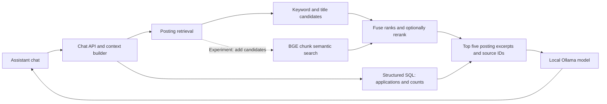
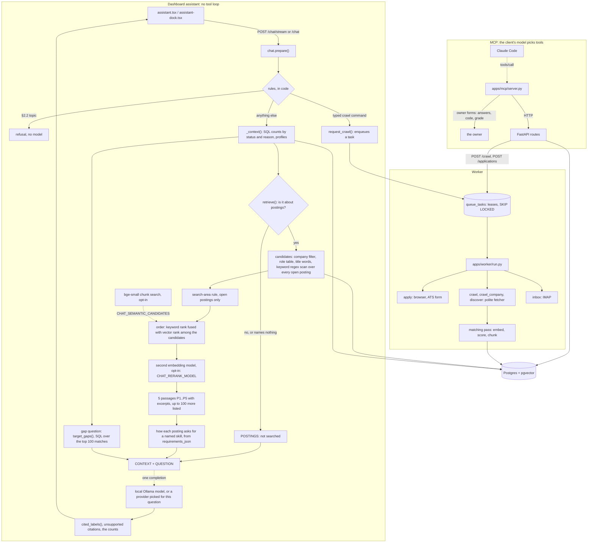

# Measuring the matcher

What the ranking numbers mean, what they are allowed to claim, and what would
have to arrive before any of them could be called production evidence.

Run it:

```bash
make bench-matching
make bench-matching ARGS="--tag adjacent --k 5"
make bench-matching ARGS="--holdout 0.3 --seed 0 --json /tmp/run.json"
```

---

## Why this exists

CLAUDE.md Gate 5 asks that "the ones you'd actually apply rank in the top 10",
and `tests/test_matching.py` checks exactly that. It is a real gate and it is
nearly blind:

- It cannot see a wanted posting slide from rank 1 to rank 10.
- It cannot compare two scorers that both pass.
- It reports one bit where the question — is this ranking better than that
  one — needs a number and an interval around it.

So there was no way to answer "did that change help", which makes every other
improvement to the matcher unfalsifiable.

| Piece | Where |
|---|---|
| Ranking and classification metrics | `packages/matching/metrics.py` |
| Labeled corpus, provenance, leak-safe splitting | `packages/matching/labels.py` |
| Variant comparison, experiment records | `packages/matching/benchmark.py` |
| The labels themselves | `seeds/labeled_matches.yaml` |
| CLI | `scripts/bench_matching.py` |
| Tests | `tests/test_matching_metrics.py` |

No new dependency. The metrics are arithmetic, and a reader should be able to
check them by hand against the worked examples in the test file — which is
where every expected value came from, rather than from the implementation.

---

## The result, as of this writing

32 labeled postings, one synthetic backend profile, lexical embedder:

```
variant                  ndcg@10            95% CI     P@k     MAP     ROC  ms/item
production+seniority       0.978       [0.93,1.00]   1.000   0.982   0.972    0.325
production                 0.965       [0.87,1.00]   0.900   0.938   0.929    0.791
body_only                  0.957       [0.86,1.00]   0.900   0.935   0.931    0.111
jaccard                    0.942       [0.85,1.00]   0.900   0.934   0.927    0.013
title_only                 0.715       [0.42,0.91]   0.800   0.858   0.875    0.109
constant                   0.000       [0.00,0.01]   0.000   0.372   0.500    0.001

leader              : production+seniority
statistically tied  : production, body_only, jaccard
production candidate: NO
```

Four things in that table are worth more than the ordering.

**The shipped scorer is not distinguishable from token overlap.** `jaccard` is
five lines — the Jaccard index of the token sets — and it sits inside the
leader's confidence interval at **1/60th of the latency**. On this data the
embedding, the 0.35/0.65 weighting, and the role-alias floor have not been
shown to buy anything. That is not a claim that they are useless; it is a
claim that 32 synthetic labels cannot see the difference, which is a different
and more honest statement than the one the table's ordering suggests.

**The original Gate 5 labels measure nothing about ranking.** Restricted to
the twenty postings the gate uses, `production` and `jaccard` both score a
perfect 1.000. The negatives are pastry chefs, truck drivers and baristas; any
scorer separates those from a backend role. `test_the_original_gate5_labels_cannot_tell_the_variants_apart`
asserts this so it stays visible.

**On adjacent roles everything collapses.** Restricted to the twelve roles
that share vocabulary with the profile and differ on something real —
`Engineering Manager, Backend` (every technology matches, the job is
management), `Senior Frontend Engineer` (title matches almost perfectly, no
overlap in the work), `Backend Engineer (Go)` (right job, wrong language) —
NDCG@5 drops to **0.577**, and the constant control is statistically tied with
everything. This is where the matcher's real weakness lives, and it was
invisible before there were hard negatives to expose it.

**That 0.577 is the plain lexical embedder's number, and neither benchmark run
is the feed's.** `bench_matching` scores with `LexicalEmbedder` unless
`--real-embedder` is passed. The `embedder:` line under the header says so, and
the figure above was quoted without it. With bge-small the same twelve give
`production` **0.405**. The run is in the hybrid section below.

This paragraph first called bge-small "the embedder the feed actually uses",
because the owner's `.env` names it. It is not. Once corpus statistics exist,
as they have since 2026-09-18, `incremental.run_matching_pass` scores with
`LexicalEmbedder(frequencies=…)`, the IDF-weighted `lexical-idf@2`, whatever
`EMBEDDING_BACKEND` says. bge-small is reached only while the corpus is too
small to weight. The benchmark runs neither that embedder nor those weights, so
the feed's own number on these twelve is unmeasured. Of the two that were
measured, plain lexical (0.577) is the closer relative: the same tokenizer and
hashing, without the weights.

**The seniority filter is off by default and costs precision.** `filters.seniority_ok`
returns `True` whenever `target_seniority` is unset. The consequence is
measurable: `Junior Backend Engineer` — a perfect technology match at the wrong
level — ranks in the top ten, and P@10 goes from 0.900 to 1.000 when the target
is armed. Deciding whether to arm it by default is a separate change; this is
the number to decide it against.

This used to add "and no production caller sets one", which was true of the code
and is no longer true of the product: `apply_filters` reads the profile's own
rung, and `/profile` has the control it shipped without. Unset is still the
default, so the number above is still the number — what changed is that arming
it no longer takes curl.

**The same is now true of a years demand, and it has no number yet.**
`filters.experience_ok` excludes a posting whose *mandatory* experience
requirement exceeds `profiles.max_required_experience_years`
(`matching/experience.py`). It is unmeasured here on purpose: the Gate 5
postings are fixtures and none of them states a years requirement, so running
the benchmark with a bound armed would report a difference of exactly zero and
invite the reading that the filter does nothing. The twelve crawled postings in
`tests/fixtures/golden/` do state them — 7 of 12 — but carry no relevance
labels, which is P1 again.

---

## Rules the harness enforces in code

**Ties are broken against the scorer.** A scorer returning the same number for
everything produces one tie group; under a stable sort its NDCG is whatever
the input order happened to be, so a null model that has learned nothing can
report a perfect ranking. `TieBreak.PESSIMISTIC` puts the less relevant item
first, and it is the default and the reported number. The control's 0.000
above is that rule working.

**The control is a row in the table.** `constant` returns 0.5 for everything.
Any variant that cannot clear it by more than the bootstrap interval has not
been shown to rank. Most benchmark tables have no row like this.

**A verdict names what it cannot claim.** `summarize()` returns
`production_candidate: False` and lists blockers. Today: the labels are
fixture-only, and 32 items is below the ~100 needed for differences this size
to survive resampling. `test_fixture_only_labels_block_a_production_claim`
holds it there — no run over synthetic labels may report a production
candidate, however good the numbers look.

**A variant never sees the grade.** The scoring callable takes the profile
text and a posting. `test_a_variant_never_sees_the_relevance_label` flips a
label and asserts the score does not move — the master spec's §45 objection to
self-grading, checked rather than promised.

**Splits group by company.** Two postings from one employer share
boilerplate, so splitting them across train and holdout lets a model recognise
the company instead of the job. `split()` groups first, deterministically on
the group name, so adding a posting does not reshuffle everything before it.

**Provenance is required, never defaulted.** A missing `provenance` field
raises. The safe default would be `fixture`, so a set of real owner labels
that lost the field in an edit would quietly understate itself — the one
direction of error that makes real numbers look synthetic.

---

## What is deliberately not here

**No trained ranker.** No XGBoost, no LambdaMART, no cross-encoder. The master
spec asks for all of them benchmarked, and benchmarking them honestly needs
labels this repo does not have: 32 fixture-graded postings for a single
profile cannot fit a learning-to-rank model without memorising them, and a
model fitted on them would report a number that means nothing. The spec's own
§66 says what to do in this situation — build the pipeline, the baselines and
the evaluation, and state what data is missing. That is what this is.

The harness is model-agnostic on purpose: a trained ranker becomes a `Variant`
with a `score` callable and gets the same table, the same control, and the
same refusal to overclaim.

**No calibration in production.** `expected_calibration_error` and
`brier_score` exist and nothing calls them yet. They matter because
`Profile.min_match_score` compares a raw cosine against a threshold, so the
units have to mean something — but calibrating against fixture labels would
fit the fixtures. It waits for the same real labels everything else does.

---

## What would have to arrive

In rough order of how much each would buy:

1. **~100 owner-labeled real postings.** The single blocker on every claim
   here. A crawl already produces the postings; grading them 0-3 in
   `seeds/labeled_matches.yaml` with `provenance: owner` is the work. At that
   point the fixture-only blocker clears and the intervals narrow enough to
   separate variants that are currently tied.
2. **Hard negatives from the owner's own feed.** The twelve adjacent roles
   here were written, not observed. Real ones — the postings the owner scrolled
   past — are better, and they are free: `provenance: feedback`, derived from
   decisions the feed already asks for.
3. **A second profile.** Every number above describes one synthetic backend
   profile. Nothing has been shown to generalise across profiles because there
   is only one.
4. **Outcome labels.** Interview conversion is the metric the system actually
   exists to move. It is also the noisiest and the slowest, and per the spec's
   §37 a rejection is not proof of a bad match.

Until (1), treat everything in this document as a regression signal: it will
tell you when a change made the matcher worse, and it will not tell you that
the matcher is good.

---

## Hybrid retrieval, and the experiment this machine could not finish

`packages/matching/hybrid.py` adds Reciprocal Rank Fusion of the dense cosine
with BM25, as two benchmark variants (`hybrid_rrf`, `bm25_only`). It exists
because this document already names where the matcher is weak and the weakness
has the shape a lexical signal is supposed to fix: on the twelve adjacent
roles NDCG@5 is 0.577 with the constant control statistically tied against
everything, and adjacent roles differ from each other in a handful of tokens
that an embedding is *designed* to collapse.

**The result, run here on 2026-09-30:**

```text
variant                   ndcg@5            95% CI     P@k     MAP     ROC
production+seniority       0.774       [0.47,1.00]   1.000   0.959   0.906
jaccard                    0.599       [0.17,0.96]   0.800   0.701   0.578
production                 0.577       [0.16,1.00]   0.800   0.739   0.656
hybrid_rrf                 0.452       [0.15,0.94]   0.800   0.718   0.594
bm25_only                  0.452       [0.13,0.91]   0.800   0.685   0.500
constant                   0.062       [0.00,0.45]   0.200   0.490   0.500

hybrid_rrf: dense/lexical rank agreement rho=+0.916
```

**That row is not a verdict on hybrid retrieval, and the last line is why.**
RRF combines signals that fail differently. `sentence-transformers` is not
installed here, so `embed.get_embedder` falls back to `LexicalEmbedder` — a
hashed bag of words — and the "dense" side of the fusion was reading the same
information as BM25. Spearman **+0.916**. The experiment had one signal in it.

Two things follow, and the second is the reason this section exists at all:

- `hybrid_rrf` scoring level with `bm25_only` to three decimals is the
  ablation doing its job. It was put there to detect exactly this.
- **A number that cannot be interpreted is more dangerous than no number.**
  Reported without the correlation, 0.452 reads as "hybrid retrieval was tried
  and lost", which would close the question on the strength of a run that
  never tested it. `hybrid.agreement` is computed on every fusion pass,
  recorded in the experiment record so it survives into `--json`, and printed
  under the table with the refusal spelled out.

**Finishing it needs the owner's machine.** `BAAI/bge-small-en-v1.5` downloads
from `huggingface.co`, which this environment's network policy denies at
CONNECT with a 403 — the same wall `make validate-seeds` and the live gates
hit. On a machine with the `embeddings` extra installed and the model cached:

```bash
make bench-matching ARGS="--tag adjacent --k 5 --real-embedder"
```

Read `rho` first. Below ~0.85 the fusion row is a real measurement; at 0.9 and
above it is still the degenerate case and the NDCG means nothing.

**What would still be true if it wins.** Nothing promotes on twelve
fixture-grade labels. The verdict block already refuses, for both reasons it
always gives, and a win here would move the question to the labeling loop
rather than to the scorer.

### Finished on the owner's machine, 2026-09-30

bge-small cached, `EMBEDDING_BACKEND=sentence-transformers`, same labeled set
(`f29a1c8be0ec5700`). The numbers reproduce exactly across runs:

```text
--tag adjacent --k 5 --real-embedder
variant                   ndcg@5            95% CI     P@k     MAP     ROC
jaccard                    0.599       [0.17,0.96]   0.800   0.701   0.578
production+seniority       0.597       [0.28,1.00]   0.800   0.876   0.812
bm25_only                  0.452       [0.13,0.91]   0.800   0.685   0.500
body_only                  0.436       [0.08,1.00]   0.600   0.645   0.469
production                 0.405       [0.10,0.95]   0.600   0.684   0.562
hybrid_rrf                 0.358       [0.06,0.85]   0.600   0.654   0.516
title_only                 0.263       [0.00,0.87]   0.400   0.724   0.438
constant                   0.062       [0.00,0.45]   0.200   0.490   0.500

hybrid_rrf: dense/lexical rank agreement rho=+0.573
```

**This time the row is a measurement, and fusion lost.** At +0.573 the two
signals order the adjacent roles differently, which is the precondition RRF
needs, and the fused ranking still came in below both of its inputs. The
mechanism shows in the top five. The fusion carries the same two false
positives as `production`: `adj-junior-backend` and `adj-eng-manager`. BM25
alone kept the manager out, and fusion let it back in.

What it does not say: every row except the control sits inside every other
row's interval, and the verdict block still names no candidate for both of its
usual reasons. The whole claim is that fusion did not help on twelve
fixture-grade labels. Hybrid retrieval stays a benchmark variant and
`Match.score` is unchanged.

Three things this run found that the first one could not:

- **The recorded 0.577 was the lexical fallback**, as noted under the adjacent
  roles above. On bge-small, `production` is 0.405 on the adjacent slice
  (lexical 0.577) and 0.992 at NDCG@10 on Gate 5 (lexical 1.000). The hashed
  bag of words beating bge-small here fits the pattern CLAUDE.md §15 keeps
  recording. These fixtures were written beside keyword-matching code, so they
  reward keyword overlap. That is not evidence that bge-small is the worse
  embedder, and nothing here separates the two.
- **The degenerate check fired with the real embedder loaded, and its advice
  was wrong.** With bge-small, agreement is **+0.875** on the Gate 5 slice and
  +0.911 on all 32, because pastry chefs rank last under any scorer. The
  message then told the reader to install the `embeddings` extra, which was
  already installed. `hybrid.agreement_note` now tells the two causes apart.
  The lexical fallback is told to install the extra. A real embedder is told
  that the slice cannot discriminate and pointed at `--tag adjacent`.
- **Arming seniority is the one change ahead under both embedders**: 0.597
  against 0.405 on bge-small, and 0.774 against 0.577 on lexical. It drops
  `adj-junior-backend` from the top five, which is the P@10 finding above seen
  from a harder slice. The lead is still inside the interval. It points at the
  `target_seniority` default decision rather than at the scorer.

### The reranker is deliberately not built

The natural third stage is a cross-encoder — `cross-encoder/ms-marco-MiniLM-L-12-v2`
is free, local, CPU-runnable, and jointly encodes (query, passage) rather than
comparing two independent vectors, which is precisely the comparison a cosine
is worst at. It is not here because it needs `torch`, nothing in this
environment can download the weights, and an unmeasured ranking stage is the
shape this repo keeps finding as a defect: a column, a filter and tests with
no way to fire. It is recorded as a candidate with its cost attached rather
than shipped dark.

### Why BM25 is in the tree rather than a dependency

`rank_bm25` is MIT and §3 would permit it. Two reasons not to:

- It would tokenize differently. `hybrid.BM25` scores through
  `embed.tokenize`, the same function the dense side uses, so a fusion
  experiment measures fusion rather than two tokenizers disagreeing about
  `node.js`.
- **It is what a production path would run.** The obvious lexical source is
  Postgres full-text search, which this repo already has a server for — but
  `ts_rank_cd` is a different ranking function from the one measured here, so
  a benchmark won on BM25 would not transfer to a feed served by FTS.
  `apps/api/routers/matches.py` already filters in Python rather than SQL, for
  the same reason it always has: the fields are read out of text. Same code
  both sides, or the number means nothing.

## Embedding models for the assistant's search, and the re-ranker (2026-10-05)

This is about the assistant's chunk search (`matching/retrieve.py`), not the
feed's score. *The reranker is deliberately not built*, above, is about the
feed and still stands: nothing here touches `Match.score`.

### What was measured

56 open in-area postings were drawn at random. Nemotron (OpenRouter) wrote two
questions for each: a **natural** one that may use the posting's words but not
its company, and a **paraphrased** one that may not reuse the title or any
technology, product or company name. Each model embedded the same chunk texts
(the stored 500-character chunks) and ranked the pool by each posting's best
chunk. The score is the rank of the posting a question was written from.

All four models ran on the M4's GPU (MPS; Qwen 4B through Ollama).

| pool | | bge-small | bge-large | Qwen3-Embedding-0.6B | Qwen3-Embedding-4B (Q4) |
|---|---|---|---|---|---|
| 1,000 postings, 14,112 chunks, 1.35M tokens | natural, top 5 | 64% | 71% | 80% | not run |
| | paraphrased, top 5 | 11% | 29% | 34% | not run |
| 400 postings, 5,652 chunks, 543K tokens | natural, top 5 | 77% | 79% | 93% | 91% |
| | paraphrased, top 5 | 32% | 45% | 52% | 71% |

Paired differences in MRR, 95% bootstrap interval over questions:

| comparison | natural | paraphrased |
|---|---|---|
| bge-large over bge-small (1,000) | +0.078 [+0.019, +0.147] | +0.088 [+0.036, +0.149] |
| Qwen 0.6B over bge-large (1,000) | +0.081 [+0.013, +0.150] | +0.062 [-0.009, +0.138] |
| Qwen 4B over Qwen 0.6B (400) | +0.046 [-0.036, +0.132] | +0.114 [+0.019, +0.212] |

So the order is Qwen 4B, Qwen 0.6B, bge-large, bge-small. Two of the steps are
not established: 0.6B over bge-large on paraphrased questions, and 4B over
0.6B on natural ones.

### What each costs on the owner's machine

| | bge-small | bge-large | Qwen 0.6B | Qwen 4B (Q4) |
|---|---|---|---|---|
| chunks per second | 366 | 34 | 19 | 3.3 |
| the corpus: 141,603 chunks, 13.6M tokens | 6 min | 69 min | 2 hours | 12 hours |
| dimensions | 384 | 1,024 | 1,024 | 2,560 |
| stored as `halfvec` | 109 MB | 290 MB | 290 MB | 725 MB |

Three things learned running them:

- **Time a model on distinct texts.** A probe that sent one sentence 64 times
  reported 29 chunks a second for Qwen 4B. On real chunks it does 3.3.
- **Cap Ollama's context.** Qwen 4B loaded at Ollama's default 32,768-token
  context took 8.7 GB of 16; at 1,024 it took 3.3 GB.
- **Half precision did not help here.** Qwen 0.6B in fp16 on MPS was no faster
  than fp32 and peaked at 2.7-3.1 GB against 0.85 GB. Batches of 8 were
  fastest (18.7 chunks a second, against 17.0 at 32 and 15.5 at 64).

Qwen's vectors can be shortened. Qwen 4B's first 384 numbers, re-normalised,
still put the right posting in the top five for 55% of paraphrased questions
on the 400 pool, above bge-large's 45% at 1,024. Shortening saves storage and
search time, not embedding time.

### The re-ranker

Re-embedding the corpus is the expensive way to use a better model. The cheap
way keeps bge-small and has the better model re-score only the best chunk of
the top candidates. Simulated from the saved vectors, 1,000 pool, top 5:

| | natural | paraphrased | one-off cost |
|---|---|---|---|
| bge-small alone | 64% | 11% | none |
| bge-small, then Qwen 0.6B on the top 30 | 77% | 36% | none |
| bge-small, then Qwen 0.6B on the top 100 | 71% | 29% | none |
| Qwen 0.6B for everything | 80% | 34% | 2 hours |

That is what `matching/rerank.py` does, with `CHAT_RERANK_MODEL` naming the
model. On the 400 pool Qwen 4B as the re-ranker reached 84% and 52%: it cannot
find what bge-small's top 30 left out, and at 3.3 chunks a second it costs
about 9 s a question against 1.6 s.

Measured on the live database (10,589 open postings) with the real model: a
question went from 0.4-1.0 s to 1.7-2.3 s, and free memory from 58% to 42%
with both models loaded.

### The re-ranker, measured live: it did not help

The table above is a simulation, and the last section warned that the shipped
path differs from it. On 2026-10-05 the same 56 postings and 112 questions
were run through the assistant's real `retrieve()`, over all 10,589 open
postings (141,603 chunks, 13.6M tokens), once with the re-ranker patched out
and once with Qwen3-Embedding-0.6B on the top 30. All 56 postings are inside
the search area. The score is where the posting a question was written from
lands among the five shown to the model and the list under the answer.

| | natural, off | natural, on | paraphrased, off | paraphrased, on |
|---|---|---|---|---|
| first | 50% | 48% | 4% | 2% |
| in the five shown | 70% | 64% | 7% | 7% |
| in the first 15 | 82% | 79% | 12% | 14% |
| anywhere in the list | 86% | 86% | 16% | 16% |
| MRR | 0.602 | 0.568 | 0.054 | 0.045 |
| median time | 0.52 s | 2.13 s | 0.81 s | 2.36 s |

Per question, the re-ranker moved the right posting up on 4 natural questions
and down on 11, and up on 4 paraphrased ones and down on 5. The rest did not
move.

Why the simulation did not carry over:

- **It re-ranked a different first stage.** The simulation's top 30 came from
  bge-small vectors alone. The shipped top 30 is chosen by keywords and
  ordered by keyword score, with a title match counted twice, then fused with
  vector rank. That order is already good when the question names the job,
  and the re-ranker throws it away: "What Primary Care Nurse Practitioner jobs
  are available for adult patient care?" went from rank 2 to 21.
- **A re-orderer cannot add what was not found.** For 47 of the 56 paraphrased
  questions the posting never entered the list, because the question shares no
  distinguishing word with it. "Anywhere in the list" is identical with the
  re-ranker on and off, as it has to be.

What this establishes and does not: 70% against 64% is three questions of 56,
so the re-ranker being *worse* is not shown. That it is *no better*, for 1.6 s
a question and a second model in memory, is. It is off on the owner's machine.
8 of the 56 natural questions were answered by the role path (CLAUDE.md §22),
which finds postings by title and was not part of the simulation at all.

The paraphrased row is the real gap, and it is the one CLAUDE.md §20 already
measured from the other side: letting vectors add candidates reaches
paraphrases and brings near-topic noise with it. That is a change to which
postings are found, not to their order.

The script is `storage/embed_rank_bench/er_live.py`; it makes no LLM call.

### What this does not establish

- 56 postings, and one free model wrote every question. Enough to order four
  models; the percentages will move on the owner's own questions.
- The pools are 400 and 1,000 postings against 10,589 live, so every
  percentage here is higher than the assistant's would be.
- The re-ranking rows are simulated from stored vectors. The shipped path also
  fuses keyword rank and applies the search area before the re-ranker runs.
  This is the caveat that mattered: see *The re-ranker, measured live*, above.
- A second check, each model's top five on 8 open questions graded by an LLM,
  has not run: the OpenRouter allowance was spent.

The benchmark scripts and vectors are in `storage/embed_rank_bench/`, which
git ignores. Committing it as a repeatable command is still to do.

## EmbeddingGemma 2 on one day's postings (2026-10-06)

The owner asked for `google/embeddinggemma-2` to be tried on the day's
postings, in a column of its own. It reads 8,192 tokens, so a posting goes in
as one vector: `postings.description_embedding_gemma`, half precision, 768
numbers. Nothing in the product read it.

**The column is gone.** The owner had it dropped the same day, once the
result was in, and the migration that added it was removed with it: it never
reached `main`. The 1,261 vectors are kept as a file beside the scripts, so
the table below can be reproduced without the column.

1,261 postings first seen that day were embedded whole (1,505,405 tokens,
median 1,146 a posting, longest 2,960). Gemini wrote a natural and a
paraphrased question for 40 of them, with the rules used for the 56 benchmark
postings. Each question was asked of the 1,261, and the score is where the
posting it was written from landed.

| | natural, top 5 | natural, MRR | paraphrased, top 5 | paraphrased, MRR |
|---|---|---|---|---|
| EmbeddingGemma 2, one vector a posting | 37 of 40 | 0.808 | 16 of 40 | 0.253 |
| bge-small, best chunk (what the assistant ranks by) | 30 | 0.577 | 11 | 0.232 |
| bge-small, best chunk or the title's vector | 39 | 0.865 | 12 | 0.195 |
| bge-small, one vector a posting (first 512 tokens) | 16 | 0.368 | 11 | 0.205 |

What it shows:

- **As one vector for a whole posting it is far better than bge-small**: 37
  against 16 on natural questions. That is the 512-token window, measured
  from the other side: bge-small's single vector never reads the requirements.
- **Against the chunk search, its lead on natural questions was the title.**
  The model card's document form is `title: <title> | text: <body>`, and the
  chunks never contain a title. Once bge-small may also match the title, it is
  ahead: 39 against 37, and higher on 9 questions to gemma's 5. The shipped
  search already finds a named job by its title, through keywords.
- **On paraphrased questions it is a little ahead and that is not
  established.** 16 against 11 or 12 in the top five; by rank, higher on 21 or
  22 questions and lower on 17.

What it cost on the owner's machine: 605 s for the 1,261 (2.1 postings a
second, 2,490 tokens a second), so about 90 minutes for the 11,148 open
postings, with 2.2 GB held on the GPU. Three things only running it showed:

- **It needs sentence-transformers 6.1; the project has 6.0.** It ran in an
  environment of its own, fed from a file.
- **Its loader imports the image and audio libraries even for text**:
  pillow, torchvision, torchaudio, librosa, soundfile. Loaded with
  `config_kwargs={"vision_config": None, "audio_config": None}` it is 271M
  parameters of the 740M.
- **Four postings a batch ran out of GPU memory 104 postings in.** Batches
  are cut by padded tokens now (3,000), and the cache is emptied after each.

What this does not establish: 40 postings and one model writing the
questions, Gemini here and Nemotron for the 56. Gemini's natural questions
are mostly the title ("What are the Catering Assistant roles available?"),
which is why the title control mattered. The pool is one day, 1,261 postings
against 11,148, so every number is higher than it would be live. And none of
it went through `retrieve()`: the last time a better model was put through
the real search it changed nothing, because keywords choose the candidates.

Scripts are in `storage/embed_rank_bench/` (`er_gemma_dump.py`,
`er_gemma_embed.py`, `er_gemma_questions.py`, `er_gemma_today.py`), with the
vectors and questions in `gemma_today/`. The comparison reads the vectors from
that file now. When this table was made it searched the column in Postgres,
with the same ranking: nearest by cosine, ties by id.

## A cross-encoder for the assistant's search (2026-10-08)

A second forum reply to the comparison above suggested keeping bge-small,
taking its top 50 postings by vector, and re-ranking those with a small
cross-encoder. Its other points were already true here: every model's query
prefix is applied in the benchmark and in the product, and the 12 hours for
Qwen 4B is a one-off that the live test above made moot.

Measured in three steps on the same benchmark. Of its 56 postings 49 were
still open, all in the search area: 98 questions. The corpus that day was
11,147 open postings and 142,577 current chunks (about 13.7M tokens at the
ratio measured on 2026-10-05). "Of 49" throughout is the posting a question
was written from.

### How deep the first stage would have to go

A re-ranker can only re-order what it is handed, so the ceiling came first.
Every open posting ranked by its best bge-small chunk, the whole question
with bge's search prefix:

| in the top | 5 | 10 | 30 | 50 | 100 | 200 |
|---|---|---|---|---|---|---|
| natural, search area only | 23 | 27 | 33 | 37 | 38 | 45 |
| natural, every open posting | 18 | 24 | 30 | 34 | 37 | 39 |
| paraphrased, search area only | 1 | 2 | 10 | 15 | 19 | 25 |
| paraphrased, every open posting | 1 | 1 | 4 | 9 | 15 | 19 |

The shipped search the same day showed 37 natural and 2 paraphrased in its
five, and had 42 and 5 anywhere in its list. Its list or the vector top 50
together held 47 and 18. So vectors alone are worse than the shipped search
on natural questions, and the two together are the pool worth judging.

### In simulation

Each question's candidates (the shipped list, and the vector top 100) were
written out with bge-small in one process, and scored by one cross-encoder in
another: 28,216 distinct question and passage pairs.

| | parameters | pairs a second | tokens | time | held |
|---|---|---|---|---|---|
| `cross-encoder/ms-marco-MiniLM-L-12-v2` | 33M | 246 (GPU) | 3.37M | 115 s | 1.05 GB |
| `BAAI/bge-reranker-base` | 278M | 39 (CPU) | 3.88M | 12 min | 2.06 GB |

Right posting in the top five, natural / paraphrased, with each passage read
as its best chunk under a line naming the title, company and place:

| what is re-ranked | MiniLM | bge-reranker-base |
|---|---|---|
| nothing: the shipped order | 37 / 2 | 37 / 2 |
| the shipped list | 39 / 3 | 39 / 4 |
| the vector top 50 alone (the reply, as written) | 33 / 2 | 34 / 4 |
| the shipped list and the vector top 50 | 43 / 3 | 43 / 3 |
| the shipped list and the vector top 100 | 41 / 3 | 43 / 1 |
| the list and the top 50, fused with the shipped order | 45 / 4 | 45 / 4 |
| the list and the top 100, fused with the shipped order | 44 / 4 | 45 / 5 |

- **The title line is what made it work.** With the chunk alone, natural
  questions came out at 24 to 28 for the rows that are not fused and 33 to 34
  for the two that are: every row under the shipped 37. That is the passage
  the Qwen re-ranker read in the live test above.
- **The model eight times the size bought nothing.**
- **Paraphrased questions did not move**, though the right posting was in
  the pool for 18 to 21 of them. bge-reranker-base scored those postings at a
  median 0.046 (after squashing to 0..1). For a question about a word no
  posting contains, the best of fifty passages scored at most 0.044.

For the 50 questions about a dictionary word in no open posting, the shipped
search returned nothing for all 50.

### Through the real search

Built on that (`packages/matching/rerank.py`, `retrieve.py`), then run
through `retrieve()` as `/chat` calls it, over every open posting, three
ways. MiniLM, on the CPU.

| | no re-ranker | only re-ordering | candidates added |
|---|---|---|---|
| natural: first | 22 | 26 | 26 |
| natural: in the five shown | 37 | 38 | 40 |
| natural: anywhere in the list | 42 | 42 | 45 |
| natural: MRR | 0.575 | 0.647 | 0.664 |
| natural: MRR over no re-ranker | | +0.072 [+0.028, +0.127] | +0.089 [+0.043, +0.145] |
| natural: ranked higher / lower | | 12 / 1 | 15 / 1 |
| paraphrased: in the five shown | 2 | 3 | 3 |
| paraphrased: anywhere in the list | 5 | 5 | 11 |
| paraphrased: MRR over no re-ranker | | -0.002 [-0.044, +0.030] | +0.017 [-0.034, +0.068] |
| a word in no posting (50): answered with nothing | 50 | 50 | 50 |
| a word a few postings have (40): shown / not saying it | 125 / 0 | 125 / 0 | 126 / 1 |
| median time, natural | 1.1 s | 1.7 s | 2.3 to 2.7 s |

It ran twice. The first build left out the candidates the model rejected
before ranking the rest, which is not what the simulation had done, and
showed 39 with candidates added (+0.084 [+0.039, +0.139]). Ranked among
everything it judged, 40. The middle column is from the first run; its code
path is the same in both.

Why not 45: the simulation re-ordered everything, and the search puts a
posting asked for by its title first. In four questions five or more
postings go first for their title alone and the one the question was written
from is not among them. In two of the four the model put it first of the
rest, at ranks 8 and 12.

### What this does not establish

- 49 postings, and one free model wrote every question. A natural question
  mostly names the title or the company, which is what the title line adds.
- The simulation compared seven pools, two passage forms and two models on
  the same questions, and the live number was looked at twice. The best row
  of any of these is partly picked.
- The times are CPU times beside a running API and dashboard. Inside the API
  process, on the GPU with bge-small, it has not been timed.
- Nothing here helps a question worded unlike its posting. Some of the
  paraphrased questions are worded unlike anything a person would type
  ("increasing pace of creating handheld programs" for a mobile engineer),
  so that split overstates the gap, and a set of realistic ones is what would
  show how much is left.

Scripts and results are in `storage/embed_rank_bench/`: `er_vector_recall.py`,
`er_xenc_plan.py`, `er_xenc_score.py`, `er_xenc_report.py`, `er_live_xenc.py`,
and `er_watch.py`, which kills a run when the machine's free memory falls
under a floor.

## Semantic candidate expansion through the assistant (2026-10-10)

> Kept as it was written. Its union was replaced the same night, and the
> section after this one has why, the numbers for what replaced it, and a
> check on questions nothing was fitted to. The decision below did not
> change.

**Decision: keep the experiment disabled.** Adding semantic candidates improves
discovery of paraphrased targets, but too few reach the five passages given to
the assistant. Natural-question hit rate also falls. This change is available
behind `CHAT_SEMANTIC_CANDIDATES=false`; the local `.env` was not changed.

### How the assistant uses the database



The model receives retrieved context; it does not query the database itself.
The dashboard path uses application code and database queries. The existing
MCP server forwards to HTTP endpoints and is not part of this chat retrieval
path. Changing the transport to MCP would not fix candidate selection or ranking.

At inspection, the database held 11,147 open postings and 142,577 current neural
chunks covering 10,676 of them. The remaining 471 had no current neural chunks.
Whole-posting vectors used `lexical-idf@2`; semantic chunk search used
`BAAI/bge-small-en-v1.5` (384 dimensions, 500-character chunks, 25-character
overlap) in pgvector. The normal keyword branch uses vectors to rank an already
selected pool, so a semantically relevant posting with no keyword overlap may
never become a candidate.

### What changed

- The opt-in branch adds up to 30 neural candidates to the keyword pool, using
  the complete question for semantic discovery. It searches up to 200 nearest
  chunks before deduplicating postings and applying the candidate limit.
- Company, search-area, open-posting, model, and chunk-freshness filters still
  apply. Explicit role/title pools remain constrained; company-only queries
  retain their existing path. This is not semantic expansion of every intent.
- Independent keyword and semantic lists are combined with reciprocal rank
  fusion. A candidate absent from a list receives no contribution from it.
  New semantic matches retain the excerpt that justified their retrieval.
- The existing optional reranker can reorder the combined pool's first 30
  candidates. The experiment adds no model dependency or automatic download.
- With the flag off, or without an available semantic encoder, the existing
  keyword behavior remains.

Implementation: `packages/matching/retrieve.py`, `packages/core/config.py`, and
`.env.example`. Regression coverage: `tests/test_chat_semantic_candidates.py`.

### Evaluation and results

The existing generated benchmark contained 56 target postings, each with a
natural and a paraphrased question. Four targets were closed or missing, leaving
52 targets and **104 questions searched against all 11,147 open postings**.
Each question ran through `retrieve()` in three modes (312 retrievals): baseline,
combined keyword/semantic candidates, and combined candidates with the cached
`Qwen/Qwen3-Embedding-0.6B` embedding reranker. An additional five example
questions ran in all three modes.

The runner used a read-only database transaction and local models in offline
mode. Settings were changed only inside the benchmark process and restored
afterward. This comparison made no answer-generation or cloud calls.

“Top five” means the known target posting appeared in the five returned
passages. “Anywhere” includes the returned `more` list; it is not evidence that
the target was in the model's five passages. MRR is mean reciprocal target rank,
with absent targets scored zero. Latency covers retrieval, not answer generation.

| Question type | Mode | Target in top five | Target anywhere | MRR | Median retrieval |
|---|---|---:|---:|---:|---:|
| Natural | Baseline | 39/52 (75.0%) | 45/52 | 0.552 | 0.681 s |
| Natural | Combined | 36/52 (69.2%) | 49/52 | 0.572 | 0.699 s |
| Natural | Combined + reranker | 37/52 (71.2%) | 49/52 | 0.596 | 2.481 s |
| Paraphrased | Baseline | 2/52 (3.8%) | 6/52 | 0.030 | 1.009 s |
| Paraphrased | Combined | 3/52 (5.8%) | 14/52 | 0.025 | 1.038 s |
| Paraphrased | Combined + reranker | 4/52 (7.7%) | 14/52 | 0.062 | 2.667 s |

Candidate expansion brings eight additional paraphrased targets into the
returned list. With reranking, only four total reach the top five; ten of the
fourteen discovered targets remain below that cutoff. Another 38 targets are
still absent. Both discovery and ranking therefore need work. The combined
reranked mode loses two natural-question top-five hits overall and adds roughly
1.7–1.8 seconds to median retrieval time compared with baseline.

Concrete changes from baseline to combined + reranker:

| Question | Known target | Before → after |
|---|---|---|
| jobs leading teams that build and maintain payment processing platforms for corporate clients | Engineering Manager, Bill Pay | Absent → rank 4 |
| jobs overseeing efforts to streamline or automate hiring processes while improving candidate experience | Recruiting Operations and Transformation Lead | Absent → rank 1 |
| What Primary Care Nurse Practitioner jobs are available for adult patient care? | Primary Care Nurse Practitioner or Physician Assistant (Adults 14+) | Rank 3 → rank 20 |
| What Support Engineer I weekend shift roles are open? | Support Engineer I (FC, Weekend Shift) | Rank 2 → rank 12 |

### Five assistant-style examples

These are retrieval observations, not human relevance grades or proof that
every returned posting satisfies the question.

| Question | Observation |
|---|---|
| Which jobs use Kafka? | Baseline returned Human Interest, New Relic, Commure, Elastic, and Celonis postings. Combined + reranker returned Notion, Fanatics, Chime, Human Interest, and Cloudflare postings. Exact skill evidence still needs grading. |
| Which jobs involve processing continuous streams of events? | Combined + reranker returned two Celonis postings plus Roblox, Life360, and Vercel. The phrasing changes the candidate set substantially. |
| Which jobs involve RAG? | Combined + reranker returned Sierra, two Striveworks postings, Oura, and NerdWallet. Acronym matching and broader semantic relevance need separate labels. |
| Which jobs involve grounding language model answers in retrieved documents? | Baseline included two Datavant healthcare postings. Combined + reranker surfaced Roku AI Tooling, Ironclad Agentic Search, and Starburst Agent, but also Lilt Project Manager and Reflection Multilingual Data roles whose relevance needs review. |
| How many applications need my review? | All three modes retrieved no job postings for this wording. The separate structured-count path remains responsible; an earlier live assistant check returned 1. |

### Verification and limits

All **267 tests passed** in the chat, assistant source/stream, and posting-chunk
suites. The 11 new tests cover expansion without keyword overlap, the default-off
path, an empty keyword pool, company/area/closed/stale filters, explicit roles,
deduplication, missing encoders, application-status routing, the candidate bound,
and exact-title ordering. Ruff lint/format checks, targeted mypy checks, and
`git diff --check` passed.

This is a small, reused, model-generated benchmark, not a held-out evaluation
with owner-graded relevance. A missing target does not prove all five results
are irrelevant, and a target hit does not establish precision across the five.
The current comparison isolates retrieval; it does not test generated-answer
correctness. Database changes and embedding coverage can change rerun results.

Local artifacts are archived under the git-ignored directory
`storage/embed_rank_bench/candidate_union_2026-10-10/`: `results.json` contains
the complete rows, summaries, and example retrievals; `original_examples.json`
preserves the preceding live checks; `evaluate.py` repeats the comparison and
writes `rerun_results.json` without overwriting the recorded result. It also
requires the existing `storage/embed_rank_bench/embed_rank/pool.json` and cached
local models. Run from the repository root with the development database running:

```sh
HF_HUB_OFFLINE=1 TOKENIZERS_PARALLELISM=false PYTHONPATH=. .venv/bin/python storage/embed_rank_bench/candidate_union_2026-10-10/evaluate.py
```

### Follow-up report prompt

```text
Continue the Job_Runner assistant RAG investigation using the 2026-10-10
section of docs/ML_EVALUATION.md and its archived evaluation artifacts.
Keep CHAT_SEMANTIC_CANDIDATES disabled by default and do not change .env.

Diagnose why 38 of 52 paraphrased targets remain absent and why 10 of the
14 discovered targets remain below the top five. Separate intent/role routing,
missing or stale embeddings, semantic candidate limits, fusion order, and
reranker cutoff failures. Inspect concrete examples before proposing changes.
Preserve company, location, explicit-role, open-posting, and freshness rules.

Make only an evidence-supported, narrowly scoped improvement with regression
tests. Compare baseline, combined candidates, and combined plus reranker on
the same 104 questions and the five example questions. Add a separate held-out
set if suitable labels are available; otherwise report that limitation.
Use local models and a read-only live database for evaluation.

Produce a report with the actual retrieval architecture, changes, target
hit@5, target coverage anywhere, MRR, median latency, concrete wins and
regressions, test results, and remaining gaps. Distinguish retrieval quality
from answer correctness and known-target hits from top-five precision.
Do not recommend enabling the experiment unless natural-question quality is
preserved and paraphrase improvements hold on independent labeled examples.
```

## The assistant's retrieval, routing and tool paths, traced (2026-10-10 and 10-11)

> Kept as it was written, and read with one thing in mind: it describes the
> tree it was measured on, and `main` had moved. Three of the fixes below had
> landed there already, by other means, and `main`'s are what is in the tree
> now — the crawl guard is `crawl_job._one_guard_at_a_time` rather than
> `queue.decide_alone`; a grade's offer is kept by `(profile, posting)` rather
> than read once, so the form does not name the profile; and the title over
> the chunk is read by a model that judges, not by one that scores likeness.
> The prompt this reports as `assistant.system` v5 is v6, carrying these
> paragraphs and `main`'s conversation memory together. CLAUDE.md §27 records
> each of those choices. Nothing measured here was re-run after the merge.

This follows *Semantic candidate expansion through the assistant*, above, and
replaces its implementation of the union. Everything here was reproduced
before it was changed, and the retrieval work was then checked on questions
nothing had been fitted to.

**In short.**

- **Fixed, each with a test that failed first**: three races (a doubled
  approval, a grade recorded for the wrong profile, two crawls from two
  requests); questions read as naming a company they do not name; four pairs
  of paraphrases that took different paths; the gap table's counts given as
  counts of the whole corpus; a second model that demoted the job a question
  named; local-model failures that all gave one piece of advice; three MCP
  reporting gaps. 471 postings with stale chunks were re-chunked.
- **Not fixed**: paraphrased questions mostly do not find their posting, and
  the first-stage embedding model is why. A retried `apply` task can send a
  form twice. One-word company names are still read from ordinary words.
- **The semantic experiment stays off.** On the questions its ordering was
  chosen on, it now finds more and costs nothing. On 80 other questions that
  gain did not repeat: natural questions were unchanged, and paraphrased ones
  moved down more often than up. There are no relevance grades to say whether
  what it adds to the five shown is any good.

What every retrieval number below measures is where one known posting lands.
That is not answer accuracy and it is not relevance. A cited label is not a
supported claim.

### The architecture as the code has it

Three paths, read from the code on 2026-10-10. Solid arrows are code; the two
dashed ones are the only places a language model is in the loop.



What decides what:

| Decision | Made by | Side effect |
|---|---|---|
| Refuse a §2.2 question | regex and word lists in `chat.py` | none |
| Start a crawl from chat | a regex anchored to an imperative, in `chat.py` | enqueues one `crawl` task |
| Whether postings are searched at all | words of the question, the company registry, open titles (`retrieve()`) | none |
| Which postings are candidates | Postgres regex scan weighted by corpus rarity; the role alias table; title words | none |
| Search area, open or closed, chunk freshness | rules and SQL filters | none |
| Order of the candidates | reciprocal rank fusion of the keyword rank with vector ranks: `lexical-idf@2` per posting, bge-small per chunk | none |
| Semantic candidates, when the flag is on | bge-small, nearest chunks over the corpus | none |
| Re-ordering, when a model is named | Qwen3-Embedding-0.6B, a second embedding model, not a cross-encoder | none |
| Application counts, the gap table, how a posting asks for a skill | SQL and the stored `requirements_json` | none |
| The answer's words | **one** language-model completion over the context | an audit line and a timing line |
| Which postings the answer cited | a regex over the finished text | none |

The dashboard assistant is not an agent. The model is called once, is handed
text, and returns text: it has no tools, cannot run a query, and cannot start
anything. Everything it is told about the database was read by application
code before it was asked. "Run crawler" is matched on the owner's own message
before any provider is chosen, never on what a model wrote.

The tool loop is on the MCP side, and it is the client's: Claude Code's model
decides which tool to call. The server forwards each call to the HTTP API
(`apps/mcp/client.py`), so the approval gate, the state machine and the
one-crawl guard are the API's own code and there is one copy of each. MCP is
a way to reach those routes. It is not retrieval: no MCP tool embeds, ranks or
runs SQL, and moving the dashboard chat onto MCP would change none of the
numbers below.

### What was found, most consequential first

"Confirmed" means reproduced: a failing test or a measurement on the owner's
database, before any fix. "Code-level risk" means read from the code and not
reproduced. Every confirmed row has a regression test that failed first.

| # | What | Status | Where | Cause | What was done |
|---|---|---|---|---|---|
| 1 | Two approvals at once queue two runs of one application; an approval and a rejection at once are both accepted | Confirmed. Fixed | `apps/api/routers/applications.py`, `review_application`, `submit_otp` | The row was read without a lock, so each request saw `needs_review` before the other committed. With `make workers n=4`, two runs of one application is the form sent twice | The row is locked while it is decided. `tests/test_review_is_decided_once.py` |
| 2 | A grade given on a form built for one profile is recorded against another | Confirmed, both MCP protocol revisions. Fixed | `apps/mcp/server.py`, `grade_posting` | `_OFFERED` is keyed by posting, and was read once for the form and again after the owner answered. A `next_to_grade` for another profile in between replaced the entry | One read, by a resolver the form and the grade share; the form names the profile. `tests/test_mcp_grading.py` |
| 3 | Two crawl requests at once queue two crawls; two ticks ending at once schedule two successors | Confirmed with separate transactions. Fixed | `apps/worker/crawl_job.py`, `request_crawl`, `_schedule_next_tick` | A count and then an enqueue, in two statements | A transaction-scoped Postgres advisory lock taken before the count (`queue.decide_alone`). `tests/test_crawl_command.py` |
| 4 | A question that names no company is answered "no open postings at Native AI" | Confirmed on 3 of 104 benchmark questions. Fixed for two causes; one-word names remain (#17) | `packages/matching/retrieve.py`, `_named_companies` | A two-word name matched as a bag of words ("AI-native" is not Native AI), and "at fast-growing firms" matched the company Fast | Names match in order; a common word after "at" is a name only where a name would stand. `tests/test_retrieval_names.py` |
| 5 | Two ways of asking one thing take two paths | Confirmed on all four pairs. Fixed | `retrieve()`'s gate and terms | One word each: "intelligence" is rare enough to search for and "AI" is not; "review" is in a title; "target" is in 19% of descriptions | "artificial intelligence" is read as "AI"; a first-person question about applications is not a search for a title; "target" is framing; a question naming nothing is not searched. `tests/test_chat_intent_routing.py` |
| 6 | Counts over the top 100 matches are given as counts over all 11,147 postings | Confirmed in the context the model was handed. Fixed in the context and the prompt; a model can still misstate it | `chat._gaps_section`, `CHAT_SYSTEM` | The gap table's heading did not say what it was counted over, and sat under "searched 11147 of 11147" | The heading states the cohort and both larger numbers; prompt v5; `gap_postings_counted` on the reply |
| 7 | A question about postings carries the owner's résumé skills | Confirmed. Fixed | `chat.asks_about_gaps` | The gap words alone were the test, and "skills", "learn", "improve", "missing" are in questions about postings | The question must be about the owner, or about no posting |
| 8 | Semantic candidates push a job named in the question out of the five shown | Confirmed (39 to 36 of 52). Replaced, still off | `retrieve()`, the union | The two lists were fused as equals, so a semantic candidate at rank 1 tied with the best keyword match | Keyword order is kept; a title the question names is held; the rest merge by rank below |
| 9 | The second model demotes a job named in the question | Confirmed (rank 3 to 20, 2 to 12). Fixed for the cases measured | `retrieve._rerank_text` | It read a 500-character chunk, which never contains the title | It reads title, company and place above the chunk, and is not asked about a title the question names |
| 10 | Containing a skill's name is taken for asking for it | Confirmed: of five postings shown for Kafka, one requires it | context built in `chat.py` | The excerpt shows the word and not how it is asked for | A line under each posting from `requirements_json`: required, preferred, named, or one of several options, with the posting's line. `packages/matching/evidence.py` |
| 11 | `grounded: true` reads as "checked" | Confirmed by reading: it is set for every generated answer | `chat.reply_for`, `ChatReply` | It records that context was supplied | Documented in the schema. `unsupported_citations` reports a cited label that was never supplied, and the dock shows it. Five `postings_*` counts tell the numbers apart |
| 12 | A missing model and a stopped server give one message with both remedies | Confirmed against Ollama 0.40.0. Fixed | `packages/llm/provider.py`, `chat.did_not_answer` | One error type for every failure | `ModelUnreachable`, `ModelMissing`, `ModelTimedOut`, each with its own remedy. `tests/test_local_model_diagnostics.py` |
| 13 | MCP: a dead API under the name of a result; a request that got no answer fails with no words; the owner's form does not say which application | Confirmed, all three. Fixed | `apps/mcp/server.py`, `apps/mcp/client.py` | Six tools wrapped whatever came back; httpx's timeout has no message; the form showed the questions and not whose | `_under`; `ApiDidNotAnswer`, which says whether a write may have happened; the form carries the posting's address |
| 14 | 471 open postings had no usable chunks | Confirmed: stale, not failed | `posting_chunks` | Their text changed in the crawl of 2026-10-07 and the worker stopped before a matching pass reached them | `make chunk-postings`: 471 postings, 6,460 chunks (about 0.62M tokens), 42 s. 11,147 of 11,147 covered |
| 15 | "searched 0 of 11,147, 11,147 not searchable yet" for a question that named nothing | Confirmed. Fixed | `retrieve()` | An empty subject cannot be made into a vector, and was reported as a corpus that could not be read | `Retrieval.unnamed`, and a context line that says so |
| 16 | A retried `apply` task can send a form twice | Code-level risk. Not reproduced, not fixed | `apps/worker/apply_job.py`, `_submit` | `adapter.submit()` sends the form, and the `submitted` status is committed after it. A worker that dies between the two leaves a `running` application, which the next claim resumes from the top | Left alone: it is the submission path, and reproducing it means submitting. See *What is still wrong* |
| 17 | A one-word company name read from an ordinary use of the word | Confirmed on 4 of 80 held-out questions. Not fixed, on purpose | `retrieve._one_word_names_it` | "Front Desk", "sense surroundings", "managing Okta administration", "Marketo lead processing" | Left so the held-out set stays one nothing was fitted to |
| 18 | Paraphrased questions do not find their posting | Measured. Not fixed | bge-small chunk search | See *Where a target is lost* | The limit of the first-stage model, and of the benchmark |

**The chunk repair, and the section above this one.** *Embedding new
postings*, written the same night by another session, describes the corpus as
it stood before row 14: 10,676 postings with current chunks and 471 stale.
Those 471 were re-chunked at 00:16 on 2026-10-11 by `make chunk-postings`,
the existing backfill, and the count is now 11,147 of 11,147 with 149,037
current chunks and none stale: about 14.3M tokens, at the 96 tokens a chunk
measured on 2026-10-05 (13.6M over 141,603). Its timing samples are of the newest 100 and
500 postings and are not affected. The backlog it lists as waiting is no
longer there to be timed.

### Where a target is lost

Each of the 104 questions was put through `retrieve()` with the experiment on
and no second model, and every list it built on the way was kept
(`rag_trace_2026-10-10/trace.py`). Beside them, two ranks over the whole
corpus that the search itself never computes: the target's place among all
5,281 in-area postings by the keyword scan, and its place by bge-small's best
chunk. The first stage that loses each target:

| First stage that loses it | Natural | Paraphrased |
|---|---:|---:|
| Shown, in the five | 44 | 3 |
| Routing: answered from a role's postings, and the target is not one | 1 | 0 |
| Coverage: no current chunks, and outside the keyword pool | 0 | 2 |
| Candidate limit: chunk rank 31 to 100 | 0 | 8 |
| Chunk search: chunk rank 101 to 500 | 0 | 19 |
| Chunk search: chunk rank over 500 | 0 | 9 |
| Ordering: found, within a second model's 30, below the five | 7 | 7 |
| Ordering: found, below a second model's 30 | 0 | 4 |

Traced before the chunk repair, so the two coverage rows are the stale
postings. One natural row is corrected for the one-term rule described in
the next section, which was still in when the trace ran: thirty-eighth then,
seventeenth without it. No target was lost to the search area, to a closed posting or to
the 200-chunk read: every one of those is a filter doing what it says.

The two ranks, which say how far out of reach the lost ones are:

| Target's rank over the in-area corpus | Natural | Paraphrased |
|---|---:|---:|
| Keyword scan: median | 2 | 353 |
| Keyword scan: within 5 / 30 / 120 | 37 / 42 / 45 | 3 / 6 / 13 |
| Keyword scan: no search term in the posting at all | 4 | 9 |
| bge-small best chunk: median | 8 | 176 |
| bge-small best chunk: within 5 / 30 / 100 / 500 | 23 / 33 / 38 / 46 | 1 / 10 / 19 / 39 |

Read together:

- **For 28 of the 49 paraphrased misses the first-stage model is the limit.**
  bge-small puts the target outside the top 100 of 5,281. No pool this search
  could afford reaches rank 176, and nothing that only re-orders can bring
  back what was never found. This is CLAUDE.md §21's finding again, with the
  rank attached.
- **8 more are a candidate limit.** They sit at chunk rank 31 to 100, so a
  pool of 100 would hold them. They would still have to be read by a second
  model to reach the five: about 100 chunks (some 9,600 tokens) at 19 chunks
  a second on this machine is five seconds a question. Not built.
- **11 were found and ordered below five**, which is the only group a better
  ordering can help. That is what the next section is about.
- **The one natural routing row is an accident of the role table.** "What are
  the 2027 Summer Intern Software Engineer roles…" is answered from the
  software-engineer role's postings. The target is titled "2027 Summer
  Intern, MS/PhD, Software Engineer, Simulation Evaluation ML Model", and
  `roles.canonical` reads a title up to its first comma: "2027 summer
  intern", no role. The keyword scan had it first in the corpus. Not fixed:
  one case, and the table also feeds scoring and Gate 5 (CLAUDE.md §22).

And one thing about the benchmark itself. A paraphrased question was written
to share no title word with its posting, and most of them describe a kind of
job, not one job: "jobs focused on finding new clients and closing deals to
grow revenue" was written from one account-executive posting and is answered
by every one of several hundred. Where the target lands says how well one
posting can be recovered from a description that fits many. It does not say
whether the five shown answer the question, and with no relevance grades
(`posting_labels` holds 0 rows) nothing here can.

### The ordering that replaced the first union, and what it was chosen on

The first union lost natural questions for two reasons, both visible in the
trace:

- **It fused the two lists as equals.** Reciprocal rank fusion gives rank 1 of
  the semantic list the same score as rank 1 of the keyword list, so a
  posting only the keywords found at rank 5 fell to about tenth. It also
  dropped the baseline's own second signal: with the experiment on, the
  vector rank among the keyword candidates was computed and not used.
- **The second model never saw a title.** It read the chunk the first model
  ranked the posting by, 500 characters from somewhere in the description. A
  question that names the job was judged against text that does not.

Before changing `retrieve()`, the orderings were compared without it. For 25
of the 52 targets (50 questions) every candidate either mode produced was
scored by Qwen3-Embedding-0.6B twice, on the chunk alone and on the chunk
under the posting's title, company and place; `simulate.py` then re-orders
the saved lists. A target in the five shown, of 25:

| Ordering | Natural | Paraphrased |
|---|---:|---:|
| Baseline | 21 | 1 |
| First union | 18 | 2 |
| First union, second model on the chunk (what was recorded) | 18 | 2 |
| First union, second model on title and chunk | 21 | 4 |
| Titles holding 1 search term held, then union | 21 | 3 |
| Titles holding 2 held, then union | 22 | 3 |
| Titles holding 3 held, then union | 20 | 2 |
| Titles holding 2 held, then union, second model on title and chunk | **23** | **5** |
| Titles holding 2 held, then union, second model on the chunk | 23 | 3 |
| Second model as one voter of three (three-way fusion) | 20 | 2 |

So two changes, and one number that was chosen:

- **A posting the question names by its title keeps its keyword place.** When
  the title holds two of the question's search terms as whole words
  (`ANCHOR_TITLE_TERMS`, `_named_by_its_title`), the posting stays where the
  keyword order put it. Semantic candidates are merged by rank with the rest,
  below it, and the second model is not asked about it. "What Support
  Engineer I weekend shift roles are open?" names "Support Engineer I (FC,
  Weekend Shift)" this way. Held only when something could move it: with the
  experiment off and no second model the order is the keyword order,
  unchanged.
- **The second model reads the title above the chunk** (`_rerank_text`), with
  the experiment on or off.
- **Two, of 1, 2 and 3.** At 1 a paraphrase holds whatever shares one word
  with it by chance. At 3 a short title the question spells out is not held.
  This is a number fitted to 50 questions, which is why it was then run on
  80 others that had never been through `retrieve()`.
- **Two always, even when the question has one search term.** Letting the
  only term be enough was built first, on an argument, and then measured.
  Three dev questions have one term, and in each it is incidental: "Customer
  Experience Manager roles at a global network security and performance
  company" has "network", every other word being too common to search for,
  and thirty Network Engineer titles were held ahead of the job asked for
  (thirty-first with both on; first without the special case). The other two
  were equal or better without it, none was worse, and the three held-out
  questions with one term came out the same either way. It was removed, the
  six questions were re-run (`rerun_one_term.py`), and the tables below are
  after that. The files as first written are kept as
  `results_<set>_one_term_held.json`.

What this does not use: a similarity cut-off. Dropping a weak fifth result
needs a score below which a posting is not an answer, and there is no graded
set to find that score on. An invented one would be a number that looks like
a decision.

### Before and after, on the questions the ordering was chosen on

52 postings, a natural and a paraphrased question each: 104 questions over
11,147 open postings, 5,281 of them in the search area. "Recorded" is the
code before any of this, from `candidate_union_2026-10-10/results.json`; it
was re-run on 2026-10-10 before anything was changed and all 312 target ranks
came back the same. "Now" is `rag_trace_2026-10-10/results_dev.json`, after
the chunk repair. The posting a question was written from:

| Question | Mode | In the five shown | Anywhere in the list | MRR | Median retrieval |
|---|---|---:|---:|---:|---:|
| Natural | Recorded: baseline | 39/52 (75.0%) | 45 | 0.552 | 0.68 s |
| Natural | Recorded: first union | 36/52 (69.2%) | 49 | 0.572 | 0.70 s |
| Natural | Recorded: first union, second model | 37/52 (71.2%) | 49 | 0.596 | 2.48 s |
| Natural | **Now: experiment off (what ships)** | **40/52 (76.9%)** | 47 | 0.586 | 1.30 s |
| Natural | Now: off, with the second model | 42/52 (80.8%) | 47 | 0.639 | 4.31 s |
| Natural | Now: experiment on | 43/52 (82.7%) | 51 | 0.622 | 1.34 s |
| Natural | Now: on, with the second model | 46/52 (88.5%) | 51 | 0.689 | 4.58 s |
| Paraphrased | Recorded: baseline | 2/52 (3.8%) | 6 | 0.030 | 1.01 s |
| Paraphrased | Recorded: first union | 3/52 (5.8%) | 14 | 0.025 | 1.04 s |
| Paraphrased | Recorded: first union, second model | 4/52 (7.7%) | 14 | 0.062 | 2.67 s |
| Paraphrased | **Now: experiment off (what ships)** | **3/52 (5.8%)** | 6 | 0.034 | 1.96 s |
| Paraphrased | Now: off, with the second model | 3/52 (5.8%) | 6 | 0.034 | 5.14 s |
| Paraphrased | Now: experiment on | 3/52 (5.8%) | 14 | 0.032 | 2.07 s |
| Paraphrased | Now: on, with the second model | 5/52 (9.6%) | 14 | 0.060 | 5.25 s |

Per question, against "experiment off" in the same run (up / down / same):

| | Natural | Paraphrased |
|---|---|---|
| Off, with the second model | 7 / 0 / 45 | 4 / 2 / 46 |
| Experiment on | 7 / 2 / 43 | 10 / 4 / 38 |
| On, with the second model | 11 / 0 / 41 | 11 / 3 / 38 |

What moved, and why:

- **What ships gained one of each.** Natural: the two questions read as
  naming Native AI went from no result to first, and one target slipped from
  fifth to seventh when the chunk repair re-ordered its neighbours. Three
  others moved a place. Paraphrased: one target came into the five (16 to 4)
  once its posting had chunks again.
- **The second model no longer costs a question that names its job.** With
  it on and the experiment off, 7 natural questions moved up and none down
  (42 of 52, against 40 without it). Recorded, the same model took 39 to 37.
  The two regressions this work was asked about: the Primary Care Nurse
  Practitioner question is third with or without it, where it had gone to
  twentieth, and the Support Engineer I weekend-shift question is first,
  where it had gone to twelfth.
- **The experiment no longer costs natural questions on this set**: 43 of 52
  against 36 for the first union.
- **On paraphrased questions the experiment alone changes what is listed, not
  what is shown.** 14 targets in the list against 6, and 3 in the five
  either way. The second model takes that to 5.
- **Two things got worse and are in the numbers above.** With the
  experiment on, two natural targets moved down (first to fourth, and fourth
  to seventh, out of the five), and four paraphrased targets the keywords
  had found moved down as semantic candidates were merged in among them.
  With the second model, "What jobs involve keeping a new workspace running
  smoothly…" went from first to tenth: a paraphrase the keywords had right,
  and no title to hold it by.

Retrieval time is not comparable between the recorded run and this one, and
the table should not be read across them: see *Checks*, where what ships
takes 0.6 s on its own, on the committed code and the changed code alike.
Within one run, the experiment adds 0.04 to 0.22 s and the second model
about 3 s.

Of everything shown, in every mode: no closed posting and none outside the
search area, in 520 shown per mode here and 386 to 388 per mode on the
held-out set (`constraints.py`, judged by the rule `retrieve()` uses, on each
posting's full text).

### The same four modes on questions nothing was fitted to

`gemma_today/questions.json`: 40 postings first seen on 2026-10-06 and 10-07,
a natural and a paraphrased question each, written by Gemini for the
EmbeddingGemma comparison above. No posting is in both sets. None of these
80 questions had been through `retrieve()`, and the ordering was fixed before
they were. All 40 postings are still open.

| Question | Mode | In the five shown | Anywhere in the list | MRR | Median retrieval |
|---|---|---:|---:|---:|---:|
| Natural | Experiment off (what ships) | 22/40 (55.0%) | 24 | 0.477 | 0.84 s |
| Natural | Off, with the second model | 22/40 (55.0%) | 24 | 0.478 | 3.72 s |
| Natural | Experiment on | 22/40 (55.0%) | 25 | 0.475 | 0.90 s |
| Natural | On, with the second model | 22/40 (55.0%) | 25 | 0.480 | 3.70 s |
| Paraphrased | Experiment off (what ships) | 5/40 (12.5%) | 12 | 0.148 | 1.59 s |
| Paraphrased | Off, with the second model | 8/40 (20.0%) | 12 | 0.134 | 4.90 s |
| Paraphrased | Experiment on | 7/40 (17.5%) | 12 | 0.128 | 1.81 s |
| Paraphrased | On, with the second model | 7/40 (17.5%) | 12 | 0.101 | 4.93 s |

Per question, against "experiment off" (up / down / same):

| | Natural | Paraphrased |
|---|---|---|
| Off, with the second model | 1 / 1 / 38 | 5 / 4 / 31 |
| Experiment on | 1 / 1 / 38 | 2 / 8 / 30 |
| On, with the second model | 2 / 1 / 37 | 5 / 5 / 30 |

**The gains did not repeat.**

- **Natural questions are preserved and not improved**: 22 of 40 in every
  mode. On the questions the ordering was chosen on it was 40, 43 and 46 of
  52. Part of that gain was the fit.
- **On paraphrased questions the experiment found nothing new.** 12 targets
  in the list with it and 12 without, where the dev set went from 6 to 14.
  Two more reached the five and eight moved down, and the mean reciprocal
  rank fell in every mode that is not the baseline, lowest with both on
  (0.148 to 0.101).
- **Why it differs**: Gemini's paraphrases keep more of a posting's own words
  than Nemotron's, so the keyword order is already better here (12.5% in the
  five against 5.8%), and merging semantic candidates into a list that was
  right moves the right posting down.

Four of the 80 were read as naming a company and were answered from that
company's postings (#17), which is part of why the natural row is 55% and
not higher. They were left, so that this set had nothing fitted to it.

Both sets are small, both were written by a model, and each question has one
target. 22 against 22 is a tie. 2 up and 8 down is 10 questions.

### Paraphrases, routed and answered

Each question was put through the real `prepare()` before and after, on the
owner's database, read-only. The route is decided in code before any model is
asked, so it is the same every time:

| Question | Before | After |
|---|---|---|
| Show me AI engineer jobs. | role table, 66 titles | the same |
| Are there any openings for engineers working in artificial intelligence? | keyword scan on "intelligence": Governance Intelligence, Regional Intelligence Analyst, Intelligence Systems | title search for "engineers" and "AI", 118 titles; the five shown are AI Engineer postings |
| Any jobs based on AI? | title search for "AI", 240 titles | the same |
| Which roles focus on artificial intelligence? | keyword scan: Customer Intelligence, Governance Intelligence, a marketing manager | title search for "AI", 240 titles: the same five as the line above |
| What am I lagging on? | not searched; gap table | the same |
| Which skills am I missing for my target jobs? | keyword scan on "target": two growth-marketing managers, three sales and compliance roles, each with a gap line of its own; and the gap table | not searched; gap table |
| How many applications are waiting for my review? | not searched | the same |
| Do I have any applications that need me to review them? | keyword scan on "review": a Clinical Review Nurse, a Code Review product manager, three others | not searched |

The first pair still takes two paths, and that is left. "AI engineer" is an
alias in the role table and "engineers working in artificial intelligence" is
not; making it one by matching an alias's words in any order would also turn
"data engineering roles" into the data-engineer role, which
`tests/test_chat_title_words.py` holds apart. Both now lead with the same
kind of posting, and the totals say what each counted: 66 titles the role
table reads as AI or ML engineer, 118 titles holding both words.

Then all thirteen (these eight and the five examples) were asked of the
running API through `/chat/stream`, with the local model, and two of them
through `/chat` as well (`ask_live.py`, `live_answers.json`).

| | |
|---|---|
| Answered | 13 of 13, by `hf.co/unsloth/Qwen3-8B-GGUF:Q3_K_M`, `local: true` |
| First piece of the answer | median 4.9 s, longest 7.5 s, with the model in memory; 17.9 s for the one question that had to load it |
| Whole answer | median 14.0 s, longest 21.0 s |
| `/chat` against `/chat/stream`, two questions | every field but the words themselves identical |
| Citations of a posting never supplied | none in 13 |
| Largest prompt | 1,794 tokens of a 4,096 context ("Which jobs use Kafka?", with the evidence lines). The largest the changes can build, a gap question about named jobs, is about 2,570 by the same ratio. No call reached the limit |

Counts, against SQL run in the same minute:

| Asked | Answered | SQL |
|---|---|---|
| How many applications are waiting for my review? | 1 | `status = 'needs_review'`: 1 |
| Do I have any applications that need me to review them? | one | 1 |
| How many applications need my review? | 1 | 1 |
| What needs me? | 1 to review, 3 to finish by hand | 1, and 3 with `failure_reason = 'manual_completion_required'` |
| Show me AI engineer jobs. | 66: 19, 43, 2, 1, 1 by kind | 66 open in-area titles of that role, by `retrieve()` |
| Which skills am I missing for my target jobs? | "across the top 100 open matches" | 100 counted, of 4,893 open postings matched, of 11,147 open |

How the answers read against the context each was given. This is one reader
checking thirteen answers, not a metric:

- **Scope held.** Neither gap answer gave its counts as counts of all
  postings. "Which jobs use Kafka?" cited two of the five and said why: one
  prefers it ("e.g. Kafka or Kinesis"), one requires it, and "these are the
  only postings where Kafka is explicitly mentioned as a required or
  preferred skill". Before, all five were postings that "use Kafka".
  "…grounding language model answers in retrieved documents" cited the two
  Starburst postings and Snowflake's search role, and left the two
  health-records postings alone.
- **One application was counted twice, and the context was why.** The first
  run answered "you have one application that needs your review.
  Additionally, there is one in the review category under WAITING ON YOU".
  It is the same application, listed by status and again by what it needs.
  The second list now says it is part of the first, and asked again the
  answer is one.
- **A place was miscopied**: "San City, CA" for "San Francisco, CA", in one
  answer.
- **Three of eight quotations were not word for word.** "shipping agentic
  features" for "You will ship agentic features", and two like it. Each is in
  the excerpt in other words. Nothing checks a quotation.
- **"You are missing the following skills".** The prompt asks for "not on
  your résumé" and the model used the question's word, then added "not
  listed on any of your résumés".
- **One answer repeated a line written for the model**: "The owner sees the
  rest listed by kind under your answer."

The answers before these changes were not regenerated. What is reproduced for
"before" is the context each question was handed, which is deterministic, and
which is where each of the failures above came from.

### How a posting asks for a skill

"Which jobs use Kafka?" returns five postings whose excerpts all say Kafka,
in every mode. By `requirements_json`, how the five ask for it:

| Mode | Required | Preferred | Named, under no requirements heading |
|---|---:|---:|---:|
| Experiment off (what ships) | 1 | 1, as one of several options | 3, two of them as an option |
| Off, with the second model | 0 | 2, both as an option | 3 |
| Experiment on | 1 | 2, one as an option | 2, one as an option |
| On, with the second model | 0 | 2, both as an option | 3 |

One of five requires it, and with the second model none does: it prefers the
postings that talk about streaming most, which is not the ones that ask for
Kafka. Nothing ranks by this. What changed is that each posting now carries
the reading and the posting's own line, and the prompt tells the model to call
a skill required only where that line does.

An option is read from the quoted line by rule (`evidence.is_option`):
"Kafka or Kinesis", "Kafka, Kinesis, or Pub/Sub", "Kafka/Kinesis", "such as
Kafka", "e.g. Kafka". It is a rule over one line and it will miss some; the
line is always quoted beside it so a reader can check.

### The five examples

What was shown, by mode (`results_dev.json`, `examples`). Not graded. The
four in bold were read: the events posting plans conferences, the Etched one
says nothing of RAG, retrieval or a language model, and the Datavant ones
retrieve medical records. The rest were not read, and Blue Owl's security
role, which looks out of place for RAG, is about securing RAG pipelines.

| Question | What ships | Experiment on | On, with the second model |
|---|---|---|---|
| Which jobs use Kafka? | Human Interest, New Relic, Commure, Elastic, Celonis | Elastic, Life360, Notion, LiveRamp, Commure | Fanatics twice, Celonis twice, Notion |
| Which jobs involve processing continuous streams of events? | Anthropic, Commure, Shield AI, MaxInsights, Vercel | Anthropic, Shield AI, Celonis twice, and **Snowflake's Strategic Events Specialist** | Life360, Roblox, Elastic's Sr. Director of Enterprise Data, Celonis twice |
| Which jobs involve RAG? | Oura, Rescale, MaintainX, Elastic, Ironclad | Oura, Elastic, Rescale, Snowflake, and **Etched's New Media, Experiences** | Oura, Striveworks twice, Riot Games, Blue Owl's Staff Security Engineer |
| Which jobs involve grounding language model answers in retrieved documents? | Starburst twice, Snowflake, and **two Datavant Health Information Specialists** | Roku AI Tooling, Starburst twice, Abridge, Fivetran | Abridge, Reflection AI, Roku, Starburst, Tavus |
| How many applications need my review? | not searched, in every mode | | |

The fourth row is the experiment at its best: the two health-records
postings, there for the words "retrieved" and "documents", are gone. The
second and third are it at its worst: an events planner for "streams of
events", and a posting with nothing of RAG in it. Both are the same
mechanism, and without grades there is no way to count which happens more.

### MCP, the queue and the approval gate

Each of these was reproduced before it was changed. The reproductions use two
or more real database transactions, or the MCP library's own client answering
the owner's form: a single rolled-back test transaction has no second caller
in it, and a mock of the form would test the mock.

| What was tried | Before | After |
|---|---|---|
| Three approvals of one application at once (`asyncio.gather`, three sessions) | 3 accepted, 3 `apply` tasks queued | 1 accepted, 2 told `invalid_state`, 1 task |
| An approval and a rejection at once | both accepted | one accepted, the other told `invalid_state`; a run is queued only if the approval won |
| A verification code sent three times at once | 3 accepted, 3 tasks | 1 accepted, 2 `invalid_state`, 1 task |
| A crawl requested while another request has queued one and not committed | 2 crawls queued | the second waits, then is told one is waiting; 1 queued |
| The same, and the first request rolls back | (not a failure before) | the second goes through; 1 queued |
| Five crawl requests at once | 2 or more queued | 1 queued |
| Two dispatch ticks ending at once | 2 successors scheduled | 1 |
| A crawl being retried (pending, one attempt used), then asked for again | refused, as it should be | refused; one that failed for good no longer holds the place |
| A posting offered for profile A, its form open, offered again for profile B, then graded | recorded for B, stream B, in both protocol revisions | 2025-11-25: recorded for A, the form it was given on. 2026-07-28: the answer to A's form is dropped and the owner is asked about B |
| A grade when the form is closed | nothing written | nothing written |
| `list_candidates` and five other listing tools with the API down | `{"candidates": {"error": …}}` | `{"error": …}` |
| A tool call the API takes and never answers | "Error executing tool review_queue:" and nothing after the colon | `code: no_answer`; a read says it can be asked again, a write says it may have been carried out and to look first |
| The owner's form for answers, and for a code | the employer's questions, no word of which application | the posting's address is in the form's own text |

How each is held:

- **The approval gate locks the row it decides** (`session.get(...,
  with_for_update=True)`). The second caller waits, reads what the first
  left, and is refused by the check that was always there. Nothing about
  what may be approved has changed.
- **A producer that looks before it enqueues takes a lock first**
  (`queue.decide_alone`): `pg_advisory_xact_lock`, keyed by task kind. It is
  the database's, so it holds across the API, `make crawl` and the worker,
  and it ends with the transaction, so a caller that dies leaves nothing to
  clear. A partial unique index was the other pattern in this repository
  (`uq_companies_verified_board`, `uq_inbound_messages_candidate_message`)
  and does not fit: a running tick and its pending successor are two
  unfinished crawl tasks on purpose, and it would need a migration. An
  in-process lock would hold for one process of three.
- **The grade is bound by the library's resolver, not by a second lookup.**
  A resolver runs once a call and its result is handed to everything that
  asks, so the form and the grade hold one offer. Under 2026-07-28 the call
  is made again with the answer and the offer is read again; the library
  takes an answer only for the wording it was given to, and the form now
  names the profile, so an answer to a form about another profile is dropped
  and asked again. A restart empties what was offered, and the grade is then
  refused before any form with "ask `next_to_grade` first", as before.
- **The stream a grade was served from** follows the offer. A second offer of
  the same posting for the same profile can carry a newer stream. The API
  recomputes the stream and lets a client's value only weaken it
  (`routers/labels.py`), so that cannot record `unseen` for a posting the
  ranker has since scored.

Inspected and left as they are:

- **Tool errors are a result, not `isError`.** A failed API call comes back
  as `{"error": …, "code": …}` in a successful tool result. That is this
  server's convention and its tests hold it (`test_unreachable_api_is_reported_not_swallowed`),
  and the six tools that hid it under another name are fixed. A client that
  reads only `isError` would take a failure for a success: not changed,
  because it changes every tool at once.
- **Untrusted text.** A posting's description reaches the calling model
  through `next_to_grade`, `search_postings` and `my_matches`, and it can say
  anything. What stands between that and an action: the three tools that
  move something on the owner's say-so make the client ask every time, the
  answers, the code and the grade are typed by the owner into a form and are
  not arguments, every id is checked on its way into a path, and nothing
  submits. In the dashboard chat the model has no tools at all; prompt v5
  also tells it that an excerpt or a subject line is text to read.
- **Retries.** Queue handlers are written to be repeatable and the crawl is
  (change detection, upserts). The one that is not is #16.

### The local model

Checked on 2026-10-10 and 10-11, Ollama 0.40.0:

| Check | Result |
|---|---|
| Executable, server | `/usr/local/bin/ollama`; `ollama serve` listening on 127.0.0.1:11434 |
| Address the API process uses | `http://localhost:11434`. No `OLLAMA_*` variable is set in the process or in `.env`, so it is the default in `core/config.py` |
| Configured model | `hf.co/unsloth/Qwen3-8B-GGUF:Q3_K_M`, installed, 4.12 GB. `/api/ps` showed nothing loaded before the first question |
| A model Ollama does not have | HTTP 404, `{"error": "model '<tag>' not found"}`, streamed or not |
| Nothing listening | httpx: "All connection attempts failed" |

"Ollama call failed: All connection attempts failed", the error this work
started from, is the second row: the daemon was not running when that
question was asked. It is running now and the model is there.

Before, both failures produced one sentence: "The local model is not
answering (…). Start Ollama with `ollama serve`, or pull the configured model
with `ollama pull …`." A model that was not pulled told the owner to start a
daemon that had just answered them. Now, on both routes:

| Failure | Raised as | What the owner is told |
|---|---|---|
| Connection refused, or timed out connecting | `ModelUnreachable` | nothing is listening at the address, which is named; start it with `ollama serve` |
| 404 and "model … not found" | `ModelMissing` | Ollama is running and does not have that model; `ollama pull <the model asked for>` |
| No reply in time | `ModelTimedOut` | it was reached and did not reply; it may be loading the model, or short of memory; ask again |
| The prompt is longer than the context | `PromptTooLong` (unchanged) | both numbers, and `OLLAMA_NUM_CTX` |
| Anything else | `LLMError` (unchanged) | the daemon's own words, and both remedies |
| The model stops part way through a stream | an `error` frame (unchanged) | it stopped part way; no closing reply, so no half answer with sources under it |

Every one of them ends "Nothing was sent anywhere else". A test builds a
recording stand-in for `build_provider` and asserts the only provider asked
for was `ollama`: no failure reaches for a cloud provider, on `/chat` or
`/chat/stream`. The per-question provider choice and the separate consent for
recruiter mail are untouched. A 404 that is not about the model (a wrong base
URL answers 404 too) is deliberately not read as a missing model.

### What is still wrong

Passing tests say the changes do what their tests say. They do not say the
assistant's answers are right, and several things here are known not to be.

- **Paraphrased questions mostly do not find their posting.** See the tables
  above. The first-stage model is the limit for most of them, and the
  second model can only order what it is given.
- **Nothing measures whether the five shown are relevant.** There are no
  relevance grades: `posting_labels` holds 0 rows. Every retrieval number
  here is where one known posting landed. The semantic candidates add
  postings to the five shown that nobody has judged, which is the whole
  reason the experiment stays off.
- **A retried `apply` task can send a form twice (#16).**
  `apply_job._submit` calls `adapter.submit(page)`, and the move to
  `submitted` is committed by the worker afterwards. A worker that dies
  between the two leaves the application `running`; the lease expires, the
  task is claimed again, `begin_work` reads `running` as an abandoned run,
  and the pipeline runs from the top. Read from the code, not reproduced:
  reproducing it means submitting. What would close it is a record written
  and committed *before* the click ("submit attempted"), and a resumed run
  that finds one failing as `manual_completion_required` with "this may
  already have been sent" in place of clicking again. It is a change to the
  submission path and wants its own review.
- **A one-word company name is still read from an ordinary use of the word
  (#17).** On the held-out questions: "Front Desk roles" was a search of
  Front's postings, "help vehicles sense surroundings" of Sense's, "managing
  Okta administration" of Okta's own 162, and "Marketo lead processing" of a
  company with nothing open. The rule that would fix them is an employer cue
  ("at Okta", "Okta jobs"), and it would change what a bare "Stripe?" does,
  which CLAUDE.md §14 records as deliberate. Left for the owner to decide,
  and left so the held-out set had nothing fitted to it.
- **"machine learning" and "ML" are still two different questions.** Both
  are in titles (138 and 64) and "ml" is rare enough to be searched for in
  descriptions, so rewriting one as the other would stop finding postings
  that use the other. It needs both spellings matched on both sides.
- **The role table reads a title up to its first comma**, so "2027 Summer
  Intern, MS/PhD, Software Engineer, …" is not a software-engineer posting to
  it, and a question that names that role does not find it.
- **The model can still say the wrong thing about a right context.** The
  context states what each count is over, the prompt says not to widen it,
  and nothing checks the prose. `unsupported_citations` catches one kind of
  error, a label that was never supplied. A label that exists can be cited
  for something its posting does not say.
- **MCP reports a failed call as a result with an `error` key**, not as
  `isError`. A client that reads only the flag takes a failure for a success.
- **Two rules here trade one mistake for another, knowingly.** A company
  whose name is a common word is named after "at" only when it is typed with
  a capital or ends what is said, so "jobs at based in berlin", all in lower
  case, no longer means the company Based. And `evidence.is_option` reads
  "Kafka, strong communication or leadership" as Kafka offered among
  options, which understates a requirement; the line is quoted beside the
  reading for that reason.
- **"Jobs I applied to that are waiting on my review" is still searched for
  "waiting" and "review".** The gate that stops that needs the noun,
  "applications". With the verb counted too, "Which jobs can I apply to that
  use a message queue?" was searched without "queue".
- **`make lint` fails on this machine, and not on this change.** All 56
  errors are in `.agents/skills/caveman-compress/scripts/`, an untracked
  directory `ruff check .` walks into. The files changed here are clean.
- **Three other paths use the local model and were not run**: tailoring, the
  cover letter, and the local column of *Compare models*. Unchanged from
  CLAUDE.md §14.

### Whether to turn the experiment on

No. `CHAT_SEMANTIC_CANDIDATES` stays `false`, and `.env` was not touched.

- **For it**: on the 104 dev questions it now finds more targets (51 of 52
  natural in the list, 14 of 52 paraphrased against 6) and takes none of the
  natural ones out of the five on net (43 against 40). It breaks no rule:
  nothing closed and nothing outside the area in 3,628 postings shown. It
  costs 0.04 to 0.22 s a question.
- **Against it**: on the 80 held-out questions none of that repeated.
  Natural was 22 of 40 either way, it added no paraphrased target to the
  list, and it moved eight paraphrased targets down for two up. And the
  postings it adds to the five shown are unjudged: one of five examples
  gained an events planner and another a posting with nothing of the
  subject in it.
- **What would change the answer** is relevance grades, not another
  known-target run. The labeling loop (`/label`, or `next_to_grade` over
  MCP) holds 0 grades. With the five shown for a few dozen real questions
  graded in each mode, top-five precision can be compared, and a cut-off
  for a weak fifth result can be chosen on something. Until then a better
  number here is a better fit to two small sets.

The second model is a separate setting (`CHAT_RERANK_MODEL`, empty on the
owner's machine) and stays the owner's call. On the dev questions it moved
seven natural targets up and none down, where it used to cost two of them.
On the held-out set it moved one up and one down: "software engineer intern
jobs…" is answered from a role's postings, which are sorted by kind and
never held, and its target went from fifth to sixth. It costs about three
seconds a question and 0.85 GB, and on the held-out set it helped
paraphrased questions into the five (5 to 8) while lowering their mean
reciprocal rank.

### Checks

Run on 2026-10-11, after the last change:

| Check | Result |
|---|---|
| `REQUIRE_DB=1 pytest -q`, the whole suite | 3,740 passed, 2 skipped, in 299 s |
| Tests added | 150: 109 in five new files and 41 in six existing ones. Each reproduction was run red before its fix |
| `ruff check` and `ruff format --check`, every file changed or added | clean |
| `make typecheck` (mypy, seven packages, 140 files) | clean |
| `alembic check` | no new operations. No model or migration changed |
| `tsc --noEmit`, the dashboard | clean |
| `git diff --check` | clean |
| A review of the source diff by the `code-reviewer` agent, read-only | no critical or high finding. Two medium ones, both reproduced as failing tests and fixed: the applications gate fired on the verb "apply" and set aside "queue", and the "at <word>" rule looked only at the first place the word followed "at". Two low ones recorded under *What is still wrong* |

Two things about those that are not this change. `make lint` as written
fails on this machine: `ruff check .` walks into
`.agents/skills/caveman-compress/scripts/`, an untracked directory, and all
56 errors and all 4 unformatted files are there. And the `apps/` files are
outside `make typecheck`; mypy on the six touched there reports 40 errors,
against 42 on the committed versions.

**Retrieval is not slower.** The tables above show what ships at 1.3 s where
the recorded run had 0.68 s, which reads as a regression and is not one. The
evaluation process holds the second model on the same GPU and switches modes
between questions. Measured on its own (`latency_ab.py`: experiment off, no
second model, the committed code and the changed code alternating twice over
the same 60 questions):

| | Natural, median | Paraphrased, median |
|---|---:|---:|
| Committed code | 0.63 s, 0.60 s | 0.87 s, 0.83 s |
| Changed code | 0.63 s, 0.61 s | 0.82 s, 0.85 s |

### Files

Changed:

- `packages/matching/retrieve.py`: the routing fixes, company names in
  order, `unnamed`, the counts, and the union's ordering.
- `packages/matching/evidence.py` (new), `apps/api/routers/chat_evidence.py`
  (new): how a posting asks for a skill; unsupported citations.
- `packages/matching/gaps.py`: what the gap table was counted over.
- `apps/api/routers/chat.py`: whose gaps, the context's scope lines, the
  reply's counts, the local-model remedies.
- `apps/api/routers/applications.py`: the row lock on review and on a code.
- `packages/core/queue.py`, `apps/worker/crawl_job.py`: `decide_alone`.
- `apps/mcp/server.py`, `apps/mcp/client.py`: the offer read once, the form
  that names its application, failures at the top, a request that got no
  answer.
- `packages/llm/provider.py`: the three kinds of local-model failure, and an
  unreachable second copy of `_ollama_failure`'s body removed.
- `packages/llm/prompts.py`: `assistant.system` v5.
- `packages/core/schemas.py`: `ChatReply`'s new fields, all with defaults, and
  what `grounded` means. Nothing was removed or renamed.
- `apps/web/src/components/assistant.tsx`: the notice for a citation of a
  posting never supplied.
- `packages/core/config.py`, `.env.example`, `CLAUDE.md` (§27).

Tests, new: `test_chat_intent_routing.py`, `test_chat_grounding.py`,
`test_skill_evidence.py`, `test_local_model_diagnostics.py`,
`test_review_is_decided_once.py`. Added to: `test_chat_semantic_candidates.py`,
`test_retrieval_names.py`, `test_crawl_command.py`, `test_mcp.py`,
`test_mcp_grading.py`, `test_assistant_dock_sources.py`. Changed:
`test_llm_prompts.py` (the v5 digest) and one assertion in
`test_chat_retrieval.py`, where "job?" is now reported as naming nothing
instead of as a corpus that could not be searched.

Written to the owner's database: the 6,460 chunks of the repair (about
0.62M tokens), by `make chunk-postings`. Nothing else. Every measurement ran in a read-only
transaction. The thirteen live questions, and four one-character probes of
the provider's error handling, each left a line in the local audit trail; all
are local calls. No application was submitted, approved or rejected, no crawl
was started, and no employer was contacted.

### To reproduce

From the repository root, with the development database up. Each of the
scripts is read-only, and `storage/` is not in git.

```sh
B=storage/embed_rank_bench/rag_trace_2026-10-10
export HF_HUB_OFFLINE=1 TOKENIZERS_PARALLELISM=false PYTHONPATH=.

.venv/bin/python $B/trace.py dev --stages-only   # trace_dev.json: every stage's lists and ranks
.venv/bin/python $B/stages.py dev                # the first stage that loses each target
.venv/bin/python $B/simulate.py dev_scored       # orderings compared, from trace_dev_scored.json
.venv/bin/python $B/evaluate.py dev              # results_dev.json: four modes through retrieve()
.venv/bin/python $B/evaluate.py heldout          # results_heldout.json
.venv/bin/python $B/rerun_one_term.py dev heldout  # only needed for the files as first written
.venv/bin/python $B/latency_ab.py after          # what ships, timed on its own
.venv/bin/python $B/tables.py                    # the tables above
.venv/bin/python $B/constraints.py dev heldout   # closed, out of area, and the Kafka readings
.venv/bin/python $B/ask_live.py                  # live_answers.json; needs `make api` and Ollama
```

`trace.py dev`, without the flag, also scores every candidate with the second
model, both ways, which is what `simulate.py` compares; it takes about a
minute a posting. `trace_dev_scored.json` is that run for 25 of the 52, made
with the first union's code, and `simulation_dev_scored.txt` is its table.
The recorded run is `candidate_union_2026-10-10/results.json`, and
`rerun_results.json` beside it is the re-run that matched it.

The races are in the test suite and need nothing but the test database:

```sh
.venv/bin/pytest tests/test_review_is_decided_once.py tests/test_crawl_command.py \
    tests/test_mcp_grading.py -q
```
